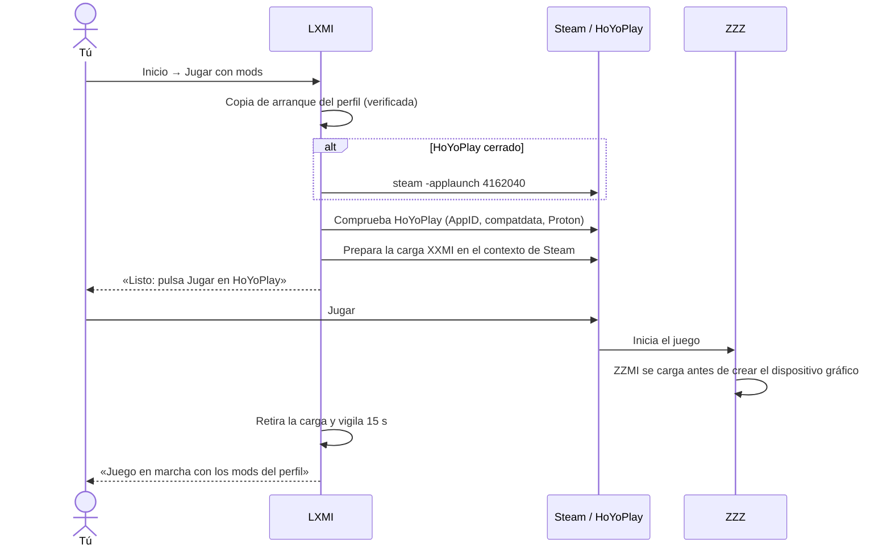

# Manual de uso de LXMI

LXMI organiza tus mods de Zenless Zone Zero (ZZZ) en Linux y abre el juego desde
Steam con el perfil que elijas, usando la carga oficial de XXMI/ZZMI. No copia
nada dentro de la carpeta del juego, de Steam ni del prefix de Proton.

> **Estado (2026-10-15):** «Jugar con mods» está validado en **ZZZ con Steam +
> Proton Experimental** en este equipo: los mods de Miyabi se vieron en partida.
> Wuthering Waves puede gestionar biblioteca y perfiles, pero su carga en el juego
> todavía no está validada y el botón aparece deshabilitado.

## 1. Requisitos

| Necesitas | Para qué |
|---|---|
| Linux con Steam (no Flatpak) | LXMI lee las bibliotecas y lanza el juego mediante `steam -applaunch` |
| ZZZ instalado desde Steam y abierto al menos una vez sin mods | Steam crea entonces `compatdata/4162040` con el prefix de Proton |
| Proton y Steam Linux Runtime que Steam use para ZZZ | LXMI los toma del propio proceso de HoYoPlay; no elige otros |
| Para compilar: Rust (toolchain del repo), Node.js, `x86_64-w64-mingw32-gcc` | MinGW compila el cargador de Windows que va dentro de la app. Sin MinGW la app compila, pero «Jugar con mods» queda deshabilitado |

## 2. Instalar y abrir la aplicación

Desde `SDLC/05_Construccion/aplicacion/apps/lxmi-desktop`:

```bash
npm install
npm run tauri:dev      # desarrollo
npm run tauri build    # paquete de la aplicación
```

## 3. Configuración inicial (una sola vez)

1. Abre ZZZ una vez desde Steam **sin LXMI**, llega al menú y ciérralo.
2. En LXMI elige **Zenless Zone Zero** en la barra lateral y entra en
   **Compatibilidad**.
3. Pulsa **Consultar paquetes oficiales** y descarga **ZZMI** y **XXMI
   Libraries**. LXMI verifica firma y SHA-256 antes de guardarlos.
4. Selecciona ambos paquetes y pulsa **Preparar runtime ZZMI**. El runtime se
   ensambla en el almacenamiento privado de LXMI, no en el juego.

## 4. Gestionar mods y perfiles

1. **Mods → Importar mod:** indica una carpeta o un ZIP de mod de ZZMI. LXMI
   guarda el original, calcula hashes y evita duplicados.
2. **Perfiles → Nuevo perfil:** marca los mods y pulsa **Guardar perfil**.
3. **Compatibilidad → Revisar aplicación del perfil** y después **Aplicar perfil
   al runtime**. Se crea una copia inmutable del runtime con esos mods.
4. **Revertir selección anterior** / **Rehacer selección** cambian entre el
   perfil actual y el anterior sin borrar nada.

El perfil aplicado aparece en **Inicio** como «Perfil seleccionado».

La barra superior tiene el selector de juego, la navegación (Inicio, Mods,
Perfiles, Compatibilidad), Diagnósticos y Configuración. En **Inicio**, el panel
de abajo a la derecha muestra el perfil, el número de mods y el botón **Jugar con
mods**; el progreso del inicio aparece encima del botón.

### Reparar un mod con avisos o demasiado pesado

`SDLC/05_Construccion/aplicacion/tools/mod-repair/repair_mod.py` crea una copia reparada sin tocar el original:
comenta secciones duplicadas y recursos sin archivo, crea imágenes sustitutas,
desactiva `.ini` que dependen de geometría ausente y, con `--max-texture 4096`,
reduce texturas de 8K. Instrucciones en
[tools/mod-repair/README.md](SDLC/05_Construccion/aplicacion/tools/mod-repair/README.md). Importa la carpeta
reparada como mod nuevo y cámbiala por la original en tu perfil.

## 5. Jugar con mods



Pasos:

1. Cierra ZZZ si está abierto. HoYoPlay puede estar abierto si lo abriste desde
   Steam; si no, LXMI lo abre.
2. En **Inicio**, pulsa **Jugar con mods**. La primera vez acepta el aviso.
3. Espera el mensaje **«Listo: pulsa Jugar en HoYoPlay ahora»**. **No pulses
   Jugar antes**: el juego no tendría mods. Si la tarjeta muestra un error,
   tampoco pulses Jugar: léelo en la tabla de la sección 6.
4. Pulsa **Jugar** en HoYoPlay (tienes 5 minutos).
5. LXMI muestra **Mods cargados** y, tras 15 segundos, **En juego**.

Ajustes de ZZZ que piden los mods de personajes de ZZMI: **Calidad de
personajes: Alta** y **Animación de personajes de alta precisión: Desactivada**.

Mientras LXMI espera a que pulses Jugar, HoYoPlay también recibe la DLL de ZZMI y
la rechaza al instante; es el comportamiento normal de la carga oficial.

### Cambiar de mods

Cierra el juego, cambia o aplica otro perfil y vuelve a pulsar **Jugar con
mods**. La recarga de mods sin reiniciar el juego todavía no existe. Las teclas
de ZZMI dentro del juego (alternar variantes, etc.) funcionan; si ZZMI guardó
su `d3dx_user.ini`, LXMI lo copia al siguiente inicio del mismo perfil.

### Jugar sin mods

**Jugar sin mods** solo pide a Steam que abra el juego; LXMI no carga nada.

## 6. Problemas frecuentes

| Mensaje o síntoma | Qué hacer |
|---|---|
| «Aplica un perfil de mods antes de jugar con mods» | Sección 4, paso 3 |
| «No existe el compatdata del juego…» | Abre ZZZ una vez desde Steam sin mods |
| «El juego ya está abierto…» | Cierra ZZZ desde su menú y espera unos segundos |
| «No se pulsó Jugar en HoYoPlay en 5 minutos» | Vuelve a pulsar **Jugar con mods**; nada quedó cargado |
| «No se identificaron Proton y Steam Linux Runtime…» | Abre HoYoPlay desde Steam (no desde un acceso directo de Wine) |
| «…AppArmor restringe los user namespaces…» o `bwrap: setting up uid map` en `helper.stderr.log` | Steam no respondió a LXMI. Abre Steam (o reinícialo) y vuelve a pulsar **Jugar con mods** |
| «HookLibrary 300» | El cargador encontró el `d3d11` de Wine en lugar del de ZZMI: informa del caso con la carpeta de arranque |
| Se cierra con `0xc0000135` | ZZMI detuvo el juego porque el dispositivo gráfico ya existía. Vuelve a intentarlo y pulsa Jugar en cuanto LXMI lo indique |
| Se cierra con otro código | Prueba un perfil con menos mods; un mod desactualizado tras una actualización del juego puede romper la carga |
| Letras rojas en pantalla al entrar | Son avisos de ZZMI sobre los `.ini` de algún mod (archivos que el mod nombra y no trae, secciones repetidas…). Los mods que sí cargan funcionan; quita o actualiza el mod defectuoso para que desaparezcan |
| El juego se pone lento y se cierra de golpe, sin mensaje | Suele ser falta de memoria: compruébalo con `journalctl -k \| grep -i "out of memory"`. Usa un perfil con menos mods o mods más ligeros y cierra otras aplicaciones pesadas. Con gráfica integrada, las texturas de los mods consumen la misma RAM |
| El juego abre pero no ves cambios | Revisa los ajustes gráficos de arriba y que el mod sea para la versión actual de ZZZ |

Si añadiste opciones de diagnóstico en Steam (Propiedades → Opciones de
lanzamiento), como `PROTON_LOG=1 … %command%`, quítalas para el uso normal:
escriben logs grandes en `/tmp` y no son necesarias.

## 7. Dónde guarda LXMI cada cosa

Todo vive en `~/.local/share/lxmi/` (o `$XDG_DATA_HOME/lxmi/`):

| Carpeta | Contenido |
|---|---|
| `mods/` | Biblioteca de mods y perfiles por juego |
| `packages/` | Paquetes oficiales ZZMI/WWMI y XXMI Libraries verificados |
| `runtimes/`, `profile-runtimes/` | Runtime base y copias inmutables por perfil |
| `launches/zenless-zone-zero/<id>/` | Copia de arranque de cada inicio con mods (se conservan las 4 más recientes) |

En cada carpeta de arranque, `helper.stdout.jsonl` registra los pasos del
cargador y `ZZMI/d3d11_log.txt` el log de ZZMI. Son lo primero que hay que
revisar si algo falla.

## 8. Límites y seguridad

- Validado en una sola combinación: ZZZ de Steam, Proton Experimental
  `experimental-11.0-20261008`, Steam Linux Runtime 4, ZZMI y XXMI Libraries
  oficiales. Otra versión de Proton o del juego puede comportarse distinto.
- LXMI no modifica Steam, la carpeta del juego ni el prefix. Las escrituras que
  veas en el prefix son del propio juego o de HoYoPlay.
- La carga dura lo mínimo: LXMI la retira en cuanto ve ZZMI en el juego o si no
  pulsas Jugar en 5 minutos. **Cancelar** detiene el cargador y la retira. Si
  cierras LXMI mientras espera, el cargador sigue y la retira él mismo en esos
  mismos casos.
- ZZZ es un juego online. Usar mods puede infringir sus condiciones de uso; el
  riesgo sobre tu cuenta es tuyo.

Detalles técnicos: [ADR-032](SDLC/04_Arquitectura_y_seguridad/ADR/032_jugar_con_mods_hook_oficial.md) ·
[verificación](SDLC/06_Verificacion/verificacion_jugar_con_mods.md).
