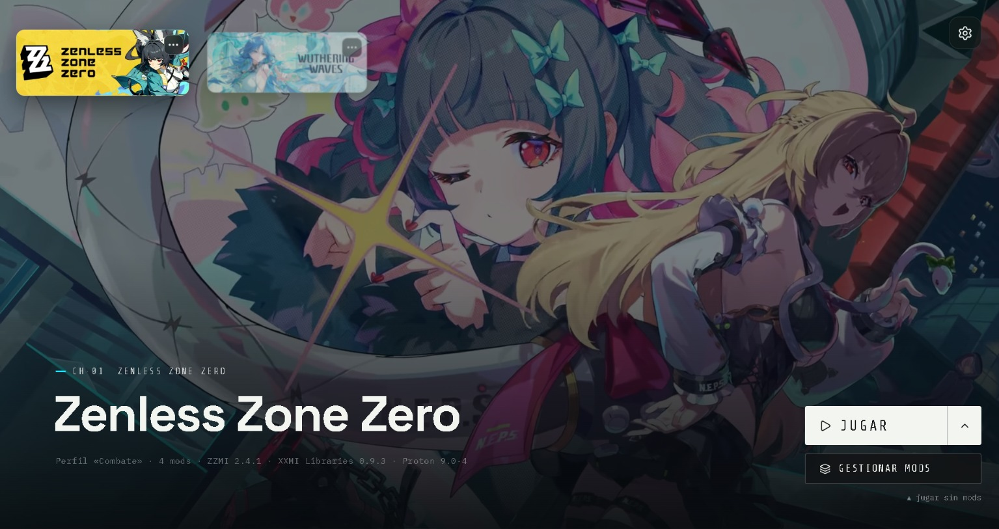
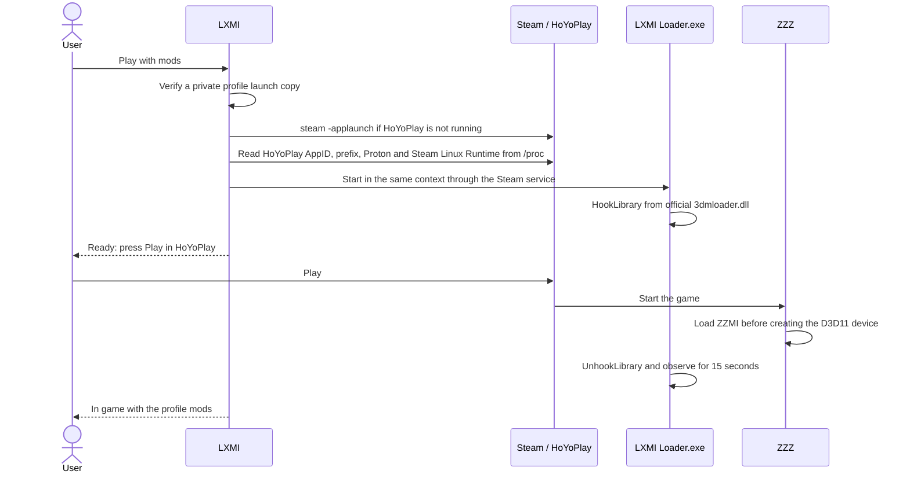

# LXMI — Linux Model Importer

A Linux mod manager for **Zenless Zone Zero** and **Wuthering Waves**, inspired by
[XXMI Launcher](https://github.com/SpectrumQT/XXMI-Launcher). Import mods into a
private library, organize them into profiles, and launch the selected profile
through Steam using the official XXMI loader (ZZMI/WWMI). LXMI keeps runtime and
profile copies outside the game installation, Steam, and the Proton prefix.



> **Status: initial release (0.8.7).** Playing with mods has been validated for ZZZ
> with Steam and Proton Experimental. Wuthering Waves supports library, profiles,
> and WWMI runtimes. Its mod loading is **experimental**: it uses Direct Inject,
> WWMI's default method, and is enabled only after local preflight checks pass.
> Gameplay was confirmed with dwproton 11.0-14 and DXVK Sarek; see the
> [tested WuWa setup](#tested-wuthering-waves-setup). Injection in an online game
> with anti-cheat may have account consequences; use test accounts only.

## Features

| Feature | Details |
|---|---|
| Mod library | Import directories or ZIP archives into private storage with SHA-256 inventories and content deduplication |
| Profiles | Save per-game mod selections; apply, undo, and redo without deleting previous runtime copies |
| Official packages | Download ZZMI/WWMI and XXMI Libraries from official releases and verify their signatures and hashes |
| Private runtimes | Assemble importers and profiles under `~/.local/share/lxmi/`, outside the game |
| Play with mods (ZZZ) | Start through Steam and arm the official XXMI hook at launch time |
| Play with mods (Wuthering Waves) | Experimental WWMI Direct Inject with static preflight and `-dx11`; gameplay tested with the documented Proton/DXVK setup |
| Play without mods | Request a normal Steam launch using `steam -applaunch` |
| Diagnostics | Inspect Steam, Proton, Steam Linux Runtime, compatdata, and managed packages |

## How playing with mods works

The validated ZZZ hook flow:



- **Launch copy.** Each launch uses a private copy under
  `~/.local/share/lxmi/launches/<game>/<id>/`, with
  `[Loader] loader = LXMI Loader.exe`. 3DMigoto activates only in the configured
  game target process and the loader.
- **Steam context.** The loader uses the Proton, Steam Linux Runtime, and wineserver
  selected by Steam for HoYoPlay. On Ubuntu,
  `apparmor_restrict_unprivileged_userns` can prevent an unconfined application from
  creating the runtime container. LXMI requests it through the Steam service using
  `steam-runtime-launch-client --alongside-steam`.
- **Short hook lifetime.** The hook is removed when ZZMI appears in the game, after
  five minutes without pressing Play, or when the launch is cancelled.

For **Wuthering Waves**, the experimental path uses Direct Inject instead of a
hook. Static preflight checks the game executable, Proton prefix, importer target,
required WWMI files, and allowed launch arguments before any process starts. LXMI
reads the explicitly selected Proton from Steam and resolves its required Steam
Linux Runtime. It stages the loader container without starting Wine, then asks
Steam to launch the game with `-dx11`. This avoids blocking Steam's
`waitforexitandrun` on a loader-owned wineserver.

Once Steam's game context appears, LXMI releases the loader into the game's
wineserver. The helper injects WWMI's own Microsoft `d3dcompiler_47.dll` first,
then `d3d11.dll`, and checks their module presence and 15 seconds of process
stability. Direct Inject accepts the exact game process up to 60 seconds older
than the helper; LXMI checks that the game is closed before requesting the launch.
These checks do not verify each mod's visual effects. The UI keeps WWMI marked
experimental and requires a separate acknowledgement from the ZZZ flow.

## Tested Wuthering Waves setup

Gameplay was confirmed on 2026-10-19 with **dwproton 11.0-14**, **Steam Linux
Runtime 4**, and **DXVK Sarek**, with Hiyuki, Hsin, and RabbitFX loaded. In Steam:

1. Open WuWa **Properties → Compatibility** and explicitly select dwproton 11.0-14.
2. Under **General → Launch Options**, use:

   ```text
   PROTON_DXVK_SAREK=1 %command%
   ```

3. Close the game and start it using **Play** in LXMI. WuWa starts directly;
   there is no separate launcher button to press.

With this dwproton version, the default DXVK 3.1.1 configuration crashed at about
75% loading in the reported tests; enabling Sarek allowed entry into gameplay.
Keep the option for this tested setup. LXMI does not set it or validate Steam's
launch options automatically. Other Proton/DXVK combinations remain unverified.
See [WWMI validation and known issues](docs/wwmi-direct-inject-validation.md).

## Requirements

| Requirement | Purpose |
|---|---|
| Linux with native Steam, outside Flatpak | Steam libraries and `steam -applaunch` |
| Game installed through Steam and opened once without mods | Creates its compatdata |
| Stable Rust, as specified in `rust-toolchain.toml` | Backend and Tauri |
| Node.js 22.19 or newer and npm | Frontend and regression tests |
| Tauri 2 Linux dependencies, including WebKitGTK 4.1 | Native window; see the [Tauri prerequisites](https://tauri.app/start/prerequisites/) |
| `x86_64-w64-mingw32-gcc`, available in `gcc-mingw-w64-x86-64` | Builds `LXMI Loader.exe`; without it, the app builds but playing with mods is disabled |

## Development

```bash
git clone git@github.com:VictorMamani/LXMI.git
cd LXMI/apps/lxmi-desktop
npm ci
npm run tauri:dev
```

This starts Vite at <http://127.0.0.1:1420> and opens the native Tauri window with
hot reload. Build application packages using `npm run tauri build`.

All maintained UI text, source comments, documentation, and development messages
are written in English. User-created mod names, profile names, and filesystem paths
are preserved as entered.

## Quick start

1. Open **Preferences**, then **Spaces**. Check Steam detection and choose
   **Prepare runtime** to download and assemble official packages.
2. Open **Mods**, select **Import**, and enter the absolute directory or ZIP path.
3. Use the profile picker to create or choose a profile, select its mods, then choose
   **Save and apply**. If activation fails after saving, the saved profile remains
   pending and can be applied again.
4. Return home and choose **Play**. Accept the first-launch explanation. For ZZZ,
   press Play in HoYoPlay when LXMI prompts you. For WuWa, configure the
   [tested setup](#tested-wuthering-waves-setup) first; LXMI starts the game
   directly. WWMI Direct Inject remains experimental and intended for test accounts.
5. Use the arrow beside **Play** to choose **Play without mods**.

To change mods, close the game, apply another profile, and launch again. Reloading
mods without restarting the game is not implemented. **Spaces** also offers runtime
updates and selection undo. Updating a runtime reapplies the active profile to the
new packages.

## Repository structure

| Path | Contents |
|---|---|
| `apps/lxmi-desktop/src/` | React and TypeScript frontend |
| `apps/lxmi-desktop/src-tauri/` | Tauri application, IPC commands, `build.rs`, and native examples |
| `crates/lxmi-core` | Shared game, Steam, and system types |
| `crates/lxmi-steam` | Steam libraries, manifests, compatdata, and compatibility settings |
| `crates/lxmi-proton` | Proton and Steam Linux Runtime discovery |
| `crates/lxmi-runtime` | Per-game runtime planning and passive observation |
| `crates/lxmi-xxmi` | Packages, mod libraries, profiles, runtime assembly, and activation |
| `crates/lxmi-launch` | Steam launch context, private launch copies, and launch state machine |
| `crates/lxmi-bridge`, `crates/lxmi-bridge-protocol` | Windows helpers in LXMI-owned test prefixes |
| `tools/lxmi-mod-loader/` | `LXMI Loader.exe`; built and embedded by `build.rs` |
| `tools/lxmi-bridge-helper/`, `tools/lxmi-context-peers/`, `tools/lxmi-loader-lab/` | Windows diagnostic helpers |

## Frontend architecture

The visual reference is **monMan v3** (pen.dev). Frontend code lives in
`apps/lxmi-desktop/src/`; components keep their CSS modules alongside their source.

| Directory | Contents |
|---|---|
| `api/` | Typed command map, `call()` transport, backend types, and demo backend |
| `domain/` | Pure game catalog, launch phases, version comparison, and formatting |
| `services/` | Save/apply and runtime update workflows |
| `state/` | Shared game, library, runtime, Steam, launch, and notification state |
| `hooks/` | Async data, user actions, and keyboard shortcuts |
| `components/` | Buttons, tags, status indicators, dialogs, menus, and fields |
| `features/home/` | Game backgrounds, cards, play actions, and launch progress |
| `features/config/` | Spaces, Mods, Share, Advanced, Laboratories, and About |
| `styles/` | Design tokens, base styles, and bundled fonts |
| `media/games/` | VP9 WebM backgrounds, WebP posters, and game covers |

All backend communication goes through `call()` in `api/client.ts`, typed by
`api/commands.ts`. Rust registers commands in `src-tauri/src/lib.rs`.

`npm run dev` opens the frontend in a regular browser with an in-memory demo backend.
It uses example data and does not touch the system. **About** identifies demo mode.
Use `npm run tauri:dev` on Linux to exercise real IPC and local game data. The demo is
not included in production builds.

### Windows development with WSL

The native Tauri window and Rust backend run in WSL2; WSLg displays the window.
Vite runs on Windows and serves the native window with hot reload.

1. Set `networkingMode=mirrored` under `[wsl2]` in `%UserProfile%\.wslconfig`, then run
   `wsl --shutdown` so Windows and WSL share localhost.
2. Install Rust in Ubuntu and the native dependencies:

   ```bash
   sudo apt install -y build-essential pkg-config libwebkit2gtk-4.1-dev libxdo-dev libssl-dev \
     libayatana-appindicator3-dev librsvg2-dev gcc-mingw-w64-x86-64 \
     gstreamer1.0-plugins-good gstreamer1.0-plugins-bad gstreamer1.0-libav
   ```

3. From the repository root on Windows, run:

   ```powershell
   powershell -ExecutionPolicy Bypass -File tools\dev-wsl.ps1
   ```

The first compilation takes several minutes. WSL build artifacts are stored in
`~/.cache/lxmi-target`. The backend sees Steam and games in the WSL distribution,
not the Windows installation.

## Checks before submitting changes

From the repository root:

```bash
cargo fmt --all -- --check
cargo clippy --workspace --all-targets -- -D warnings
cargo test --workspace
```

From `apps/lxmi-desktop`:

```bash
npm test
npm run typecheck
npm run lint
npm run format:check
npm run build
```

Browser checks do not replace native Tauri verification. Validate window controls,
WebKitGTK video support, profile activation, and runtime updates in the native app
before claiming those flows passed on a particular host.

With the Vite server running, an opt-in native smoke check inspects English UI
labels, real read-only IPC, applied profile identity, and menu keyboard focus:

```bash
LXMI_CONFIRM_NATIVE_UI_SMOKE=YES cargo run -p lxmi-desktop --example ui_native_smoke
```

It does not change the library, activate profiles, start helpers, or launch games.

## Data storage

LXMI uses `~/.local/share/lxmi/`, or `$XDG_DATA_HOME/lxmi/`:

| Directory | Contents |
|---|---|
| `mods/<game>/` | Mod library and saved profiles |
| `packages/` | Verified official packages |
| `runtimes/`, `profile-runtimes/` | Base runtimes and immutable profile runtimes |
| `launches/<game>/<id>/` | Per-launch copies; `helper.stdout.jsonl` records loader steps |

## Limitations

- ZZZ was validated with Proton Experimental and Steam Linux Runtime 4. WuWa
  gameplay was confirmed with dwproton 11.0-14, Steam Linux Runtime 4, and DXVK
  Sarek using `PROTON_DXVK_SAREK=1`. Other combinations may behave differently.
- LXMI does not bypass or modify game protection systems.
- ZZZ and Wuthering Waves are online games. Using mods may violate their terms;
  the account risk is yours.

## Credits

- [XXMI Launcher](https://github.com/SpectrumQT/XXMI-Launcher), ZZMI, WWMI, and
  XXMI Libraries by SpectrumQT and contributors. LXMI downloads official packages
  without redistributing them.
- [3DMigoto](https://github.com/bo3b/3Dmigoto), the basis of the XXMI importers.
