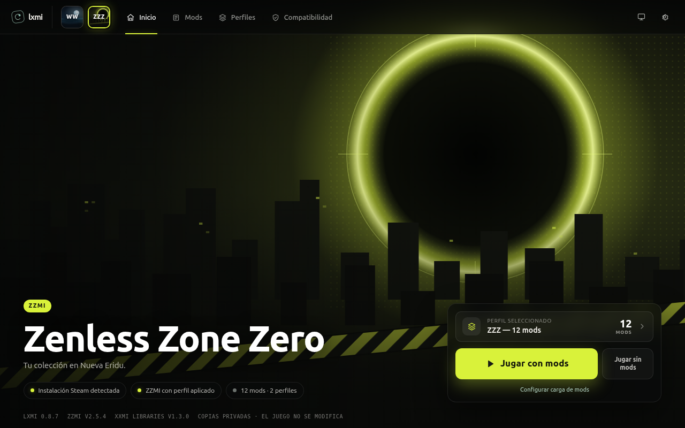
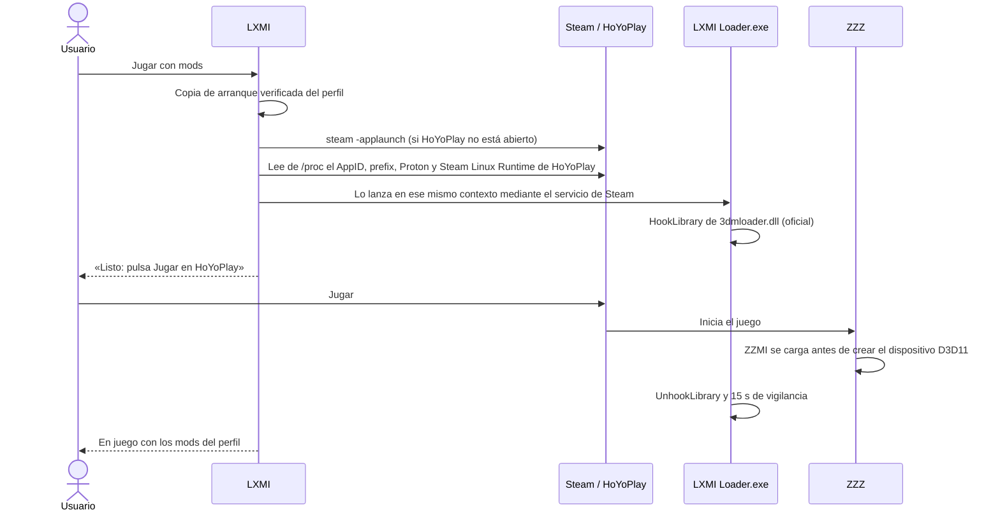

# LXMI — Linux Model Importer

Gestor de mods para **Zenless Zone Zero** y **Wuthering Waves** en Linux, inspirado en
[XXMI Launcher](https://github.com/SpectrumQT/XXMI-Launcher). Organiza tus mods en una
biblioteca privada, los agrupa en perfiles y abre el juego desde Steam con el perfil
elegido usando la carga oficial de XXMI (ZZMI/WWMI), sin modificar la instalación del
juego, Steam ni el prefix de Proton.



> **Estado: primera versión (0.8.7).** «Jugar con mods» está validado en ZZZ con Steam +
> Proton Experimental. Wuthering Waves ya gestiona biblioteca y perfiles, pero su carga
> en el juego todavía no está validada y el botón aparece deshabilitado.

## Qué hace

| Función | Detalle |
|---|---|
| Biblioteca de mods | Importa carpetas o ZIP, guarda una copia privada con inventario SHA-256 y evita duplicados |
| Perfiles | Selecciones de mods guardadas por juego; se aplican, revierten y rehacen sin borrar nada |
| Paquetes oficiales | Descarga ZZMI/WWMI y XXMI Libraries de sus releases oficiales y verifica firma y hash |
| Runtime privado | Ensambla el importador y el perfil en `~/.local/share/lxmi/`, nunca dentro del juego |
| Jugar con mods (ZZZ) | Abre el juego desde Steam y carga ZZMI con el hook oficial de XXMI justo a tiempo |
| Jugar sin mods | Pide a Steam el inicio normal (`steam -applaunch`) |
| Diagnósticos | Detección de Steam, Proton, Steam Linux Runtime, compatdata y paquetes |

## Cómo funciona «Jugar con mods»



Puntos clave:

- **Copia de arranque.** Cada inicio usa una copia privada del perfil en
  `~/.local/share/lxmi/launches/<juego>/<id>/` con `[Loader] loader = LXMI Loader.exe`.
  3DMigoto solo se activa en el proceso del juego (`target`) y en el cargador.
- **Mismo contexto que Steam.** El cargador se ejecuta con el Proton y el Steam Linux
  Runtime que Steam eligió para HoYoPlay, en su wineserver. En Ubuntu,
  `apparmor_restrict_unprivileged_userns` impide a una app sin perfil crear el contenedor
  del runtime, así que LXMI lo pide al servicio de Steam
  (`steam-runtime-launch-client --alongside-steam`).
- **Carga mínima.** El hook se retira en cuanto ZZMI aparece en el juego, si no pulsas
  Jugar en 5 minutos o al cancelar.

## Requisitos

| Necesitas | Para qué |
|---|---|
| Linux con Steam nativo (no Flatpak) | Bibliotecas de Steam y `steam -applaunch` |
| El juego instalado desde Steam y abierto una vez sin mods | Crea su `compatdata` |
| Rust estable (`rust-toolchain.toml`) | Backend y Tauri |
| Node.js 22 y npm | Frontend |
| Dependencias de Tauri 2 para Linux (WebKitGTK 4.1, etc.) | Ventana nativa; ver la [guía de Tauri](https://tauri.app/start/prerequisites/) |
| `x86_64-w64-mingw32-gcc` (`gcc-mingw-w64-x86-64`) | Compila `LXMI Loader.exe`. Sin MinGW la app compila, pero «Jugar con mods» queda deshabilitado |

## Lanzar en desarrollo

```bash
git clone git@github.com:VictorMamani/LXMI.git
cd LXMI/apps/lxmi-desktop
npm install
npm run tauri:dev
```

`tauri:dev` arranca Vite en `http://127.0.0.1:1420` y la ventana nativa con recarga en
caliente. Para generar el paquete de la aplicación: `npm run tauri build`.

## Uso rápido

1. **Compatibilidad →** Consultar paquetes oficiales, descargar ZZMI y XXMI Libraries y
   pulsar «Preparar runtime administrado».
2. **Mods → Importar mod** con la ruta de una carpeta o ZIP de mod.
3. **Perfiles →** marca mods y guarda el perfil.
4. **Compatibilidad →** Revisar aplicación del perfil y Aplicar perfil al runtime.
5. **Inicio → Jugar con mods.** Cuando aparezca «Listo: pulsa Jugar en HoYoPlay», pulsa
   Jugar.

Para cambiar de mods: cierra el juego, aplica otro perfil y vuelve a pulsar «Jugar con
mods». La recarga sin reiniciar todavía no existe.

## Estructura del repositorio

| Ruta | Contenido |
|---|---|
| `apps/lxmi-desktop/src/` | Frontend React + TypeScript |
| `apps/lxmi-desktop/src-tauri/` | Aplicación Tauri: comandos IPC, `build.rs` y ejemplos de prueba nativa |
| `crates/lxmi-core` | Tipos compartidos: juegos, Steam y sistema |
| `crates/lxmi-steam` | Detección de Steam: bibliotecas, manifests, compatdata y herramientas de compatibilidad |
| `crates/lxmi-proton` | Descubrimiento de Proton y Steam Linux Runtime |
| `crates/lxmi-runtime` | Planificación de runtime por juego |
| `crates/lxmi-xxmi` | Paquetes XXMI, biblioteca de mods, perfiles, ensamblado y activación de runtimes |
| `crates/lxmi-launch` | «Jugar con mods»: contexto Steam por procfs, copia de arranque y máquina de estados |
| `crates/lxmi-bridge`, `crates/lxmi-bridge-protocol` | Puente con helpers Windows en prefixes de prueba propios de LXMI (diagnósticos) |
| `tools/lxmi-mod-loader/` | `LXMI Loader.exe` (`HookLibrary`/`UnhookLibrary`); lo compila e incrusta `build.rs` |
| `tools/lxmi-bridge-helper/`, `tools/lxmi-context-peers/`, `tools/lxmi-loader-lab/` | Helpers Windows de los diagnósticos |

## Frontend (para trabajar la interfaz)

Diseño de referencia: «monMan v3» (pen.dev). Todo vive en `apps/lxmi-desktop/src/`,
organizado por capas; cada componente tiene su `*.module.css` al lado.

| Carpeta | Qué contiene |
|---|---|
| `api/` | `commands.ts` (mapa tipado de todos los comandos Tauri), `client.ts` (`call()`), `types.ts` y `mock/` (backend de demostración) |
| `domain/` | Lógica pura sin React: catálogo de juegos, fases de lanzamiento, versiones, formato |
| `services/` | Flujos de varios comandos: guardar y aplicar perfil, actualizar el runtime |
| `state/` | Contextos compartidos: juego activo (biblioteca y runtime), Steam, lanzamiento, avisos |
| `hooks/` | `useAsync`, `useAction`, `useHotkeys` |
| `components/` | Piezas del sistema de diseño: `Button` (primario, contorno, fantasma), `Tag`, `StatusDot`, `Dialog`, `MenuButton`… |
| `features/home/` | Inicio: video de fondo, tarjetas de juego, JUGAR y progreso de carga |
| `features/config/` | Configuración: barra lateral, cartuchos (Q / E) y las páginas Espacios, Mods, Compartir, Avanzado (con Laboratorios) y Acerca de |
| `styles/` | Tokens de color y tipografía (`tokens.css`), estilos base y fuentes empaquetadas |
| `media/games/` | Fondos animados (WebM VP9), pósters y portadas de cada juego |

Toda la comunicación con el backend pasa por `call()` de `api/client.ts`, tipado con el
mapa de `api/commands.ts`. Los comandos están registrados en
`apps/lxmi-desktop/src-tauri/src/lib.rs`.

`npm run dev` sirve el frontend en <http://127.0.0.1:1420>. Fuera de la ventana de Tauri
(por ejemplo, en Windows o en un navegador) la app usa automáticamente el backend de
demostración de `api/mock/`, con datos de ejemplo y sin tocar el sistema; «Acerca de»
indica «Modo demo». Para probar con datos reales usa `npm run tauri:dev` en Linux.

### Desarrollo en Windows (app real vía WSL)

La ventana de Tauri y el backend real corren en WSL2 (WSLg muestra la ventana); Vite
corre en Windows y la ventana lo carga con recarga en caliente. Preparación, una vez:

1. En `%UserProfile%\.wslconfig`, dentro de `[wsl2]`: `networkingMode=mirrored` (Windows y
   WSL comparten `localhost`). Luego `wsl --shutdown`.
2. En Ubuntu: Rust (`curl https://sh.rustup.rs -sSf | sh`) y los paquetes de sistema:

   ```bash
   sudo apt install -y build-essential pkg-config libwebkit2gtk-4.1-dev libxdo-dev libssl-dev \
     libayatana-appindicator3-dev librsvg2-dev gcc-mingw-w64-x86-64 \
     gstreamer1.0-plugins-good gstreamer1.0-plugins-bad gstreamer1.0-libav
   ```

Después, desde la raíz del repo en Windows:

```powershell
powershell -ExecutionPolicy Bypass -File tools\dev-wsl.ps1
```

La primera compilación tarda varios minutos; los artefactos quedan en
`~/.cache/lxmi-target` dentro de WSL. El backend ve el Steam y los juegos de la distro
de WSL, no los de Windows.

## Comprobaciones antes de subir cambios

Desde la raíz:

```bash
cargo fmt --all -- --check
cargo clippy --workspace --all-targets -- -D warnings
cargo test --workspace
```

Desde `apps/lxmi-desktop`:

```bash
npm run typecheck && npm run lint && npm run format:check && npm run build
```

Pruebas nativas opcionales (abren una ventana real y no lanzan juegos):

- `tools/test-mod-manager-native.sh` (con `npm run dev` en marcha): biblioteca y perfiles
  en un `XDG_DATA_HOME` temporal, sin tocar tus datos.
- `LXMI_CONFIRM_NATIVE_PROFILE_REVIEW=YES cargo run -p lxmi-desktop --example selected_profile_native_review`:
  revisa el perfil aplicado sin pulsar «Jugar con mods».

## Dónde guarda LXMI los datos

Todo vive en `~/.local/share/lxmi/` (o `$XDG_DATA_HOME/lxmi/`):

| Carpeta | Contenido |
|---|---|
| `mods/<juego>/` | Biblioteca de mods y perfiles |
| `packages/` | Paquetes oficiales verificados |
| `runtimes/`, `profile-runtimes/` | Runtime base y copias inmutables por perfil |
| `launches/<juego>/<id>/` | Copia de cada inicio con mods; `helper.stdout.jsonl` registra los pasos del cargador |

## Límites y aviso

- Validado en una combinación: ZZZ de Steam, Proton Experimental, Steam Linux Runtime 4,
  ZZMI y XXMI Libraries oficiales. Otras versiones pueden comportarse distinto.
- LXMI no evita ni modifica los sistemas de protección de los juegos.
- ZZZ y Wuthering Waves son juegos online. Usar mods puede infringir sus condiciones de
  uso; el riesgo sobre tu cuenta es tuyo.

## Créditos

- [XXMI Launcher](https://github.com/SpectrumQT/XXMI-Launcher), ZZMI, WWMI y XXMI
  Libraries de SpectrumQT y colaboradores: LXMI descarga y usa sus paquetes oficiales sin
  redistribuirlos.
- [3DMigoto](https://github.com/bo3b/3Dmigoto), base de los importadores XXMI.
