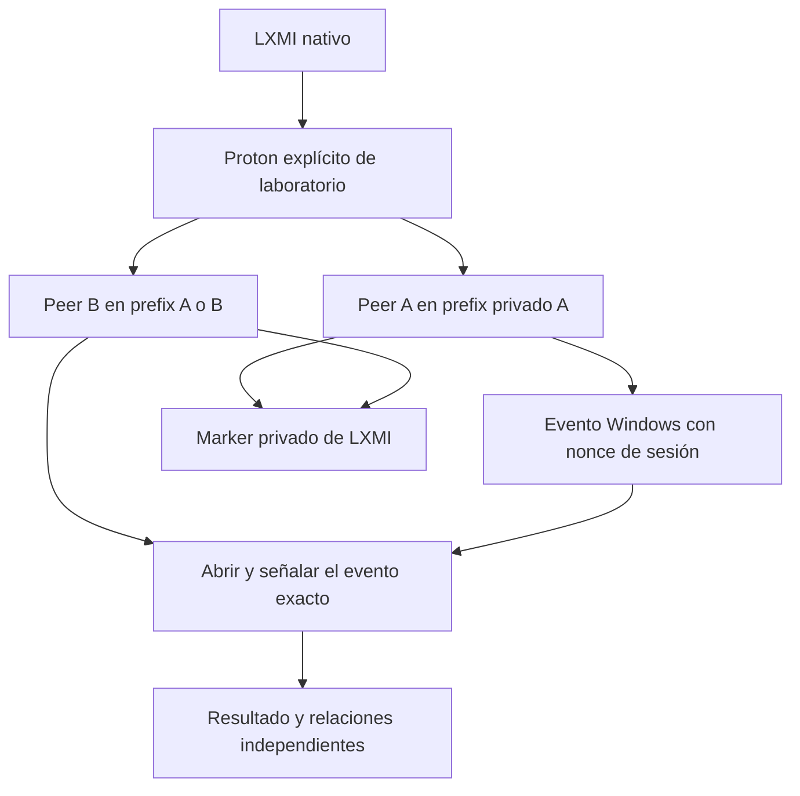

# LXMI 0.8.4 — Contexto Wine/Proton con peers aislados

Fecha de investigación y host tests: 2026-09-30 (hora local); 2026-10-01 UTC.

## Fuentes fijadas

| Fuente | Identidad | Archivo / sección |
|---|---|---|
| `wine-mirror/wine`, tag `wine-11.0` | tag object `ce295733f9a67970b7f60d7af201f2ac16441a50`; commit `db11d0fe6a169c457e23d007e20404643d067aa8` | `dlls/ntdll/unix/server.c`: `init_server_dir`, `setup_config_dir`, `server_connect`, `server_init_process` |
| Mismo Wine | mismo commit | `server/request.c`: `create_server_dir`, socket y lock de servidor |
| Mismo Wine | mismo commit | `server/event.c`: `create_event`, `open_event`, `event_op` |
| Mismo Wine | mismo commit | `dlls/ntdll/unix/loader.c`: configuración del prefix, arquitectura y arranque del servidor |
| `ValveSoftware/Proton`, referencia `proton_10.0` | commit fijado `e91ca2be0df2cef4c230cbbc0b86604d73a0bbf6` | `proton`: `CompatData`, `Session.init_wine`, `Session.init_session`, dispatch `runinprefix` |
| Microsoft Win32 | documentación `OpenEventW`, actualizada 2024-11-20 | namespaces Local/Global, handle y errores |

Los hashes de referencias se obtuvieron con `git ls-remote`; las conclusiones se contrastaron con archivos fijados. El script Proton fijado descargado tiene SHA-256 `f07e19d289a4c7a1a9047bb123a2f630b54ceef1ee2ba0d96d1990a68055635e`. La referencia `proton_10.0` es una referencia documental; NO se afirma que sea el source commit exacto del Proton Experimental instalado.

## UPSTREAM VERIFIED — selección del endpoint Wine

El cliente calcula el directorio del servidor a partir del UID y dispositivo/inodo del directorio de configuración. Intenta conectarse a su socket; valida ownership/permisos y puede arrancar el servidor si falta. Existe también un canal heredado `WINESERVERSOCKET`, que evita la búsqueda normal. Por tanto, igualdad textual de paths no prueba una instancia de proceso persistente ni cubre overrides/namespace Unix distintos. [Wine client, funciones citadas](https://github.com/wine-mirror/wine/blob/db11d0fe6a169c457e23d007e20404643d067aa8/dlls/ntdll/unix/server.c).

El lado servidor obtiene el prefix de `WINEPREFIX` (o del home si falta), verifica ownership y usa dispositivo/inodo para su directorio privado de socket/lock. Con directories de prefix distintos, los endpoints por defecto son distintos; alias de la misma directory pueden referir al mismo inode. El servidor usa un lock para evitar dos instancias simultáneas en ese endpoint. Esto describe el mecanismo fijado, no un PID estable para todas las sesiones. [Wine server](https://github.com/wine-mirror/wine/blob/db11d0fe6a169c457e23d007e20404643d067aa8/server/request.c).

`WINESERVER` permite seleccionar un ejecutable de servidor; no identifica por sí mismo una instancia o su socket. `WINEPREFIX` selecciona configuración; `WINEARCH` afecta arquitectura, no es una identidad de servidor. [Wine loader](https://github.com/wine-mirror/wine/blob/db11d0fe6a169c457e23d007e20404643d067aa8/dlls/ntdll/unix/loader.c).

## UPSTREAM VERIFIED — Proton

`CompatData` deriva `pfx/` desde `STEAM_COMPAT_DATA_PATH`; `init_session` establece `WINEPREFIX`. `init_wine` elimina `WINEARCH` heredado. `runinprefix` invoca Wine directamente después de preparar la sesión, usando el Wine de la tool. No evita necesariamente las escrituras de inicialización Wine. El script puede realizar mantenimiento de su instalación/default prefix antes del dispatch: no se asume que cualquier Proton sea un executor puramente read-only. [Proton fijado](https://github.com/ValveSoftware/Proton/blob/e91ca2be0df2cef4c230cbbc0b86604d73a0bbf6/proton).

## ARCHITECTURAL DECISION — probe de evento nombrado

Se eligió un único evento `Local\LXMIContextV1-<nonce>`. A crea el evento y conserva el handle; B abre exactamente ese nombre y lo señala. No se enumeran ni abren procesos Windows. La prueba mide visibilidad de un objeto y entrega de una señal de evento, no visibilidad de toda una tabla de procesos ni permisos de un injector. Los handlers de eventos viven en wineserver. [Wine events](https://github.com/wine-mirror/wine/blob/db11d0fe6a169c457e23d007e20404643d067aa8/server/event.c). `OpenEventW` requiere que el objeto exista y el acceso solicitado sea permitido; la documentación distingue namespaces de sesión/global. [Microsoft](https://learn.microsoft.com/en-us/windows/win32/api/synchapi/nf-synchapi-openeventw).

No se usó un renderer Mermaid ni se afirma validación visual del diagrama.

## HOST TEST — herramientas y resultados

- Proton Experimental local: ID/build `1790244902 experimental-11.0-20260924-x86_64`.
- Script local: SHA-256 `077db31dda75c570c1a91014f9a814b785307bc91e5dfb1480b984dc34166a54`.
- Dos ejecutables LXMI authored en C, compilados con MinGW GCC `13-win32`; PE32+ x86-64. Se reutiliza la toolchain MinGW del Loader Lab, sin usar sus loaders/DLLs.
- A: 303467 bytes; SHA-256 `f27fc832af4f5c7b3b7ce80b3d62cc4cdfa3137387f05105e3ce28796987f02f`.
- B: 303244 bytes; SHA-256 `eb0ff8dd610b3359900a28ea5e3b105eb998aa3de7fb457ccb8e53df58009de6`.
- Tool y peers se mantienen constantes entre casos. No había un proceso ZZZ identificado antes de las pruebas.

| Relación / resultado | Mismo prefix | Prefixes distintos |
|---|---|---|
| Proton explícito | Mismo | Mismo |
| Compatdata / prefix reportados por peers | Iguales | Distintos |
| B abre y señala el evento de A | Sí | No; Win32 2 |
| A recibe el evento | Sí | No; espera acotada de 12 s |
| Marker con nonce leído por ambos | Sí | Sí |
| Mapping del marker | `Z:` observado a `/`, lectura real | Mismo mapping y lectura real |
| Mapping completo `C:` + `Z:` | Igual | Distinto: `C:` apunta al drive_c privado de cada prefix |
| PID del wineserver realmente usado por cada peer | UNKNOWN | UNKNOWN |
| Proceso wineserver con WINEPREFIX coincidente | Candidato observado | Candidatos observados; un scan anterior no capturó B después de que salió |
| Loader / ZZMI / ZZZ | No ejecutados | No ejecutados |

Las primeras suites host ignoradas/opt-in registraron sesión `57907be471b2263cd2c6df904c0826ff9a5de3cf9b933c4eec205e6cd3aebfbf` (A/B Windows PID 220/236, candidato wineserver 731201) y control `2ec1255f5eaa626464e69cdeb841fc2be51cea692ed60afe1fa0a2116e604bae` (216/220, candidato A 731871; B no observado por ese scan). PIDs son efímeros y Windows PIDs pueden repetirse entre prefixes.

La versión final también se recorrió desde controles Tauri nativos mediante AT-SPI (sin navegador Vite): mismo prefix, Windows PID 220/236, candidato wineserver 752427 para ambos; control, PID 216/220, candidatos 753602/753653. La UI mostró marker legible en ambos casos, evento sí/no, wineserver `unknown`, `drive_mapping` distinto en el control y `marker_path_mapping` igual. No se atribuye esta interacción automatizada al usuario como prueba manual humana.

## Comparación con ZZZ 0.8.3

| Hecho | Fixture 0.8.4 | Observación histórica de ZZZ |
|---|---|---|
| Proton | Selección explícita lab; mismo build local | LOCAL OBSERVED en esa ejecución, mismo build |
| Compatdata | Nuevo directory por nonce bajo LXMI | LOCAL OBSERVED `steamapps/compatdata/4162040` |
| Prefix | Entorno reportado por peers, contrastado con plan privado | LOCAL OBSERVED `4162040/pfx/` |
| Windows path del marker | Mapping observado y archivo leído | Bridge/lab anteriores verificaron storage; no prueban visibilidad desde ZZZ |
| Wineserver | PID candidato por UID/WINEPREFIX | Candidato con prefix coincidente, no endpoint demostrado |

La referencia ZZZ viene de [0.8.3](observacion_runtime_zzz_steam_0_8_3.md). No se volvió a lanzar ni observar ZZZ para este experimento. No se copiaron sus registros/prefix. Una tool común no establece contexto compartido.

## Context join requirements y límites

**DERIVED:** en los casos medidos, compartir archivos vía `Z:` no fue suficiente para compartir el evento. El mismo prefix habilitó el probe y prefixes distintos no lo hicieron bajo la tool probada. No se generaliza a todos los Proton, sesiones, desktop/global namespaces ni overrides.

**UNKNOWN / NotEstablished para un loader futuro:** necesidad de misma tool, prefix, wineserver, sesión Windows y mappings compartidos. `ContextJoinRequirements` mantiene estos requisitos independientes. `GameContextJoinPlan` es exclusivamente datos, sin executor ni autorización de juego.

**NoDecision:** LoaderStrategy no cambia. Direct Inject sigue verificado únicamente contra el fixture 0.7. Hook sigue bloqueado. Context sharing no demuestra compatibilidad de ZZMI ni acceso a procesos del juego. El gate permanece `NeedsEvidence`, cerrado.

## Mutaciones y cleanup

Los prefixes de prueba se crean en `$XDG_DATA_HOME/lxmi/tests/context-join-v1/<nonce>/compat-a|compat-b`. Se aíslan HOME/XDG dentro de esa sesión. A/B solo leen el marker y A crea su ready marker privado. Wine puede generar además sockets/locks privados en `/tmp/.wine-<uid>`; no se oculta esta escritura del runtime. No se enviaron señales a wineserver. Los peers salen por respuesta o timeout propio. Context Lab solo puede terminar su launcher Linux hijo en timeout; la captura no bloqueante evita esperar indefinidamente pipes heredados. Los servidores privados se dejan salir naturalmente.

COMPROBADO: comparación pre/post de tamaño, mtime_ns e inode del ejecutable ZZZ, directory pfx, system.reg, user.reg y config/config.vdf no detectó cambios. Esto no equivale a hashear todo Steam/prefix/juego. No se modificaron paquetes ni runtime ZZMI administrados por el flujo del lab.
