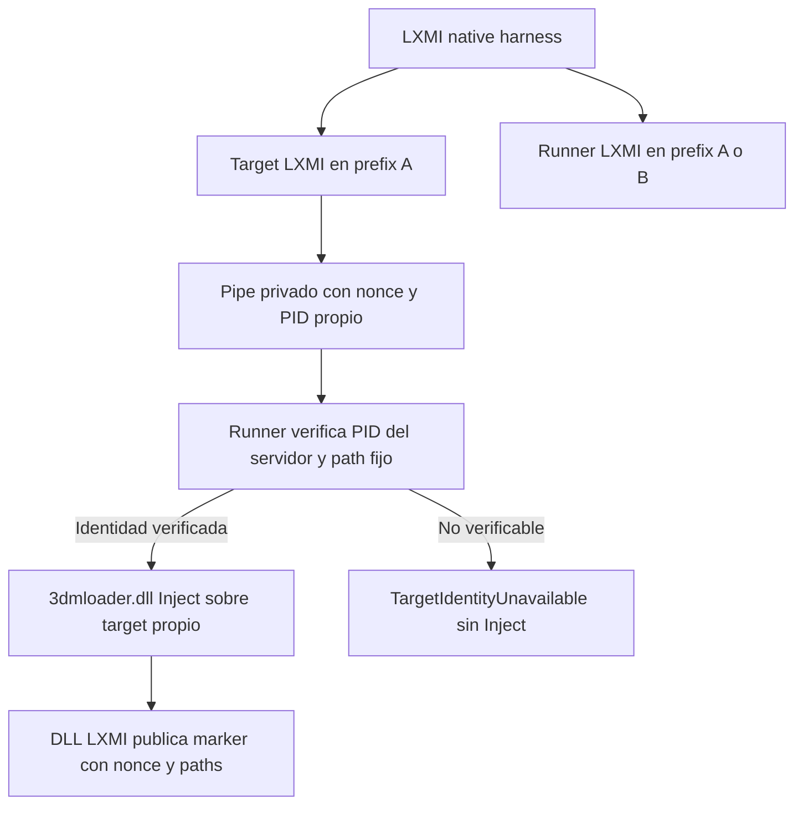

# LXMI 0.8.5 — Direct Inject Context Boundary

**Estado: PARCIAL / BLOCKED.** Mismo prefix comprobado. El control cross-prefix se ejecutó, pero el guard de identidad impidió llamar `Inject`. No se ha demostrado una carga ni un error de esa API entre prefixes. Versión de aplicación conservada en **0.8.4**; no se inicia 0.9.

## Fuentes fijadas — UPSTREAM VERIFIED

Consulta: 2026-10-01 UTC (2026-09-30, America/La_Paz).

| Fuente | Identidad | Sección |
|---|---|---|
| Wine | `wine-11.0`, commit `db11d0fe6a169c457e23d007e20404643d067aa8` | `server/process.c`: `alloc_ptid`, `ptid_from_index`, `get_process_from_id`, handler `open_process` |
| XXMI Launcher | `v2.2.1`, commit `d56786b8dacb00c35204bff45ff5b8b83bd8962a` | `dll_injector.py`: export `Inject`, PID DWORD, DLL path, timeout |
| XXMI Libraries | `v1.1.7`, commit `6bf6a746a198c82fb34dbd336cac7ad8e0f4ddc9` | Componente `3dmloader.dll` de package autenticado, revalidado por el servicio existente |
| Microsoft Win32 | documentación consultada | `GetNamedPipeServerProcessId`, identidad del servidor del pipe |

Wine asigna IDs Windows desde su tabla `ptid_entries`; `process->unix_pid` es otro campo. El handler `open_process` resuelve en la tabla del servidor correspondiente. Un número obtenido en otro contexto no autoriza seleccionar un proceso en el contexto del runner. [Código Wine fijado](https://github.com/wine-mirror/wine/blob/db11d0fe6a169c457e23d007e20404643d067aa8/server/process.c).

El wrapper XXMI recibe un PID Windows y llama al export `Inject`; no documenta aquí una traducción de PID Linux ni una conexión a otro wineserver. [Wrapper fijado](https://github.com/SpectrumQT/XXMI-Launcher/blob/d56786b8dacb00c35204bff45ff5b8b83bd8962a/src/xxmi_launcher/core/utils/dll_injector.py). No se afirma que el source Wine fijado sea el commit exacto de la build Experimental local.

## PID semantics — COMPROBADO / HOST TEST

0.7 entrega a upstream `PROCESS_INFORMATION.dwProcessId` del `CreateProcessW` propio. No usa PID Unix ni escaneo global.

0.8.5 inicia el mismo target con el executor Proton existente. El target reporta `GetCurrentProcessId` y publica un pipe de nombre fijo con nonce aleatorio. El runner recibe ese handshake y compara el PID del mensaje con `GetNamedPipeServerProcessId`. [Semántica Win32](https://learn.microsoft.com/en-us/windows/win32/api/winbase/nf-winbase-getnamedpipeserverprocessid).

Solo después de esa correlación se abre un handle **query-only** del target verificado (`SYNCHRONIZE | PROCESS_QUERY_LIMITED_INFORMATION`), se confirma el path fijo con `QueryFullProcessImageNameW` y que sigue vivo, y se mantiene el handle hasta terminar la llamada upstream. No solicita permisos de memoria, no enumera procesos, no implementa injection propia. Conservar el objeto protege frente a reutilización del PID durante la llamada. Los PID son efímeros y no forman parte del manifest durable.

## CASE A — HOST TEST

Mismo Proton y compatdata/prefix privado. Target y DLL viven en subdirectorios distintos (`target/` y `runtime/`).

- Ambos contextos leyeron el marker de filesystem con nonce.
- Handshake de identidad válido; upstream `Inject` devuelve **0**.
- Marker DLL con protocol 1, nonce, process name y paths Windows esperados: **PASS**.
- Dos invocaciones Proton independientes; target creado por el harness y correlacionado, no PID proporcionado desde frontend.
- Candidatos wineserver coinciden por UID/WINEPREFIX. Identidad exacta de endpoint: **UNKNOWN**.

## CASE B — HOST TEST / BLOCKED

Mismo Proton, usuario, sesión, target y DLL; cambia solamente compatdata/prefix del runner.

- Ambos leyeron el mismo marker de filesystem: **COMPROBADO**.
- El pipe del target no es visible desde el runner: **Win32 2** al intentar abrirlo.
- Win32 2 se registra en el probe de pipe; **no es un código retornado por 3dmloader**.
- En la primera sesión ambos procesos reportaron **PID Windows 220** en sus propios contextos. Esto evidencia que el entero no identifica globalmente al target. No se llamó `OpenProcess` ni `Inject` con ese PID en el control cross-prefix.
- Resultado: `TargetIdentityUnavailable`, `identity_bound=false`, `inject_called=false`, `inject_code=-1` (sentinela local), sin marker DLL.
- No fallback, no target nuevo en B, no búsqueda de otro PID.

**NO COMPROBADO:** qué devolvería `3dmloader.dll` al intentar Direct Inject entre estos contexts. No se envía un PID no correlacionado para obtener ese código: podría referir al runner u otro proceso en B. Este bloqueo mantiene la regla de target propio.

## Comparación con 0.8.4

El evento Windows y el pipe de identidad no cruzaron los prefixes probados; el filesystem mediante mapping Z sí fue visible. Es correlación de dos probes de objetos Windows. No demuestra por sí sola que Direct Inject tenga la misma frontera o que same-prefix sea un requisito universal.

## LoaderContextRequirements / GameContextJoinPlan

Las propiedades same tool, prefix, wineserver, sesión y shared mapping conservan `NotEstablished` como requisitos universales/del juego. `RequiredForTestedTopology` y `NotRequiredForTestedTopology` existen para futuras conclusiones explícitamente acotadas; no se asignan a partir de una llamada no realizada.

La capability del fixture same-prefix es `Verified`; la del control cross-prefix queda `Blocked`, no `Failed` de upstream. El plan declarativo incluye el resultado del fixture y un blocker sobre PID de otro namespace. No incorpora un executor ni concede permiso para entrar al prefix del juego.

La observación ZZZ 0.8.3 describe otra ejecución: Proton Experimental y `compatdata/4162040/pfx`. No se re-observó ni abrió ZZZ en este incremento. `GameRuntimePlan.selected`, LoaderStrategy `NoDecision`, Hook bloqueado, readiness `NeedsEvidence` y gate cerrado permanecen separados.

## Storage / límites

Cada run crea `$XDG_DATA_HOME/lxmi/tests/direct-context-v1/<nonce>/loader-v1/` con home/XDG/compatdata privados, target/runner/runtime/results separados. El manifest del fixture contiene hashes y provenance fuera del runtime. Los packages originales y managed ZZMI no se alteran. Configuración de frontend limitada a runtime descubierto, modo cerrado y consentimiento: no paths/PID/DLL arbitrarios.

Se reutilizan executor directo argv, timeout 45 s y output acotado 1 MiB por stream. Target tiene timeout propio 30 s; probe 5 s y espera marker 5 s. Solo se termina el launcher hijo propio al vencer su timeout, sin señales de grupo ni de wineserver. El stop marker está limitado a la sesión privada; el target sale normalmente. Wine puede escribir en estos prefixes y crear sockets privados en `/tmp/.wine-<uid>`; eso no es un efecto read-only del runtime.

## Límite para el cierre

Para cerrar la pregunta cross-prefix hace falta un mecanismo upstream documentado que resuelva y vincule **ese target propio** entre namespaces sin seleccionar un PID local homónimo. No se ha encontrado/probado ese mecanismo. No se rebaja el guard ni se accede a ZZZ para compensar la falta de evidencia.

## Revisión de readiness en esta sesión — LOCAL OBSERVED

El panel nativo, evaluado sin pareja de packages seleccionada, mostró `NotReady` / gate `not_ready`; runtime seleccionado para el juego `Unknown`, consentimiento recibido no, estrategia sin decisión. Ese input conserva `managed_runtime=Missing` en el servicio, y no demuestra ausencia física de los runtimes administrados existentes. La evidencia del fixture no rellena automáticamente selección de packages o runtime del juego. Ver [validación y resultados finales](../06_Verificacion/verificacion_0_8_5.md).
