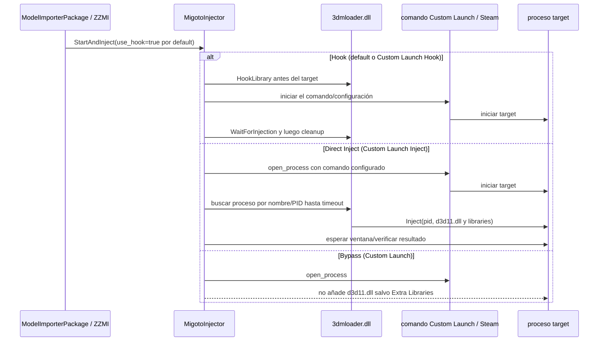
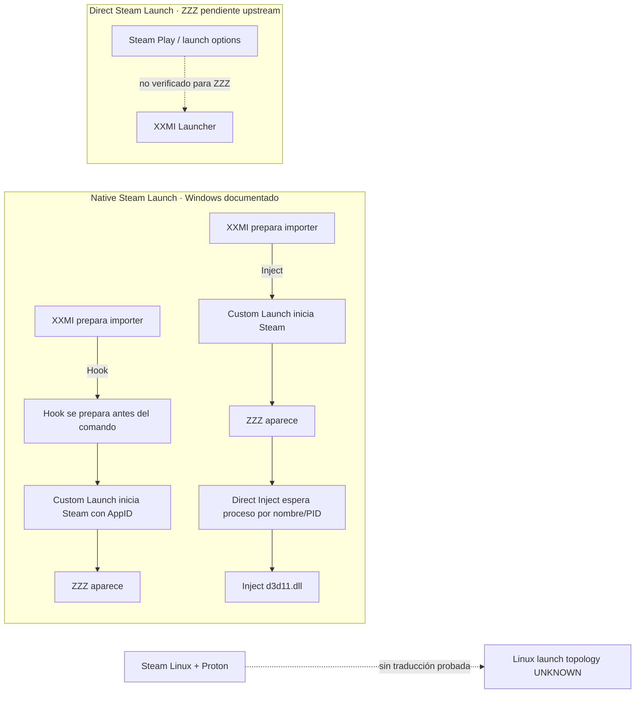

# LXMI 0.8.1 — estrategia de loader ZZMI en Linux

**Consulta:** 2026-09-29. El código de XXMI Launcher se fija a `v2.2.1`, commit `d56786b8dacb00c35204bff45ff5b8b83bd8962a`. El código de Wine se consultó como fuente de arquitectura; no es una prueba de Proton ni del binario `3dmloader.dll`.

## Fuentes y alcance

| Fuente | Referencia fijada/consultada | Uso |
|---|---|---|
| `SpectrumQT/XXMI-Launcher` | `v2.2.1`, commit `d56786b8dacb00c35204bff45ff5b8b83bd8962a`, publicado el 2026-06-11 | `model_importer.py`, `zzmi_package.py`, `migoto_package.py`, `dll_injector.py`; flujo ZZMI y modo Inject genérico. |
| `leotorrez/ZZMI-Package` | `v1.5.0`, commit `e59f87047cd405c5db5476d3b1b499574bc43d67` | Integración ZZMI, executables y configuración `d3dx.ini`. |
| `SpectrumQT/XXMI-Launcher` | release `v2.2.0`, commit mostrado `6501b0c`, publicada el 2026-06-08 | Precedente de cambio de modo predeterminado WWMI. |
| `wine-mirror/wine` (mirror del repositorio WineHQ) | `server/hook.c`, `dlls/win32u/hook.c`, `server/wineserver.man.in`, consultados 2026-09-29 en `master` | Modelo general de alcance de hooks y sesiones Wine. El mirror consultado no expuso un commit fijable en esta lectura. |

Fuentes de código XXMI fijadas: [`model_importer.py`](https://github.com/SpectrumQT/XXMI-Launcher/blob/d56786b8dacb00c35204bff45ff5b8b83bd8962a/src/xxmi_launcher/core/packages/model_importers/model_importer.py), [`zzmi_package.py`](https://github.com/SpectrumQT/XXMI-Launcher/blob/d56786b8dacb00c35204bff45ff5b8b83bd8962a/src/xxmi_launcher/core/packages/model_importers/zzmi_package.py), [`migoto_package.py`](https://github.com/SpectrumQT/XXMI-Launcher/blob/d56786b8dacb00c35204bff45ff5b8b83bd8962a/src/xxmi_launcher/core/packages/migoto_package.py) y [`dll_injector.py`](https://github.com/SpectrumQT/XXMI-Launcher/blob/d56786b8dacb00c35204bff45ff5b8b83bd8962a/src/xxmi_launcher/core/utils/dll_injector.py). La [release v2.2.1](https://github.com/SpectrumQT/XXMI-Launcher/releases/tag/v2.2.1) identifica el tag/commit. El paquete ZZMI fijado es [v1.5.0 `d3dx.ini`](https://github.com/leotorrez/ZZMI-Package/blob/e59f87047cd405c5db5476d3b1b499574bc43d67/ZZMI/d3dx.ini).

## Traza `use_hook` de ZZMI

1. `ModelImporterPackage.__init__` inicializa `self.use_hook = True`.
2. `ZZMIPackage` configura `ZZMIConfig`, pero no sobrescribe `use_hook`; ZZMI hereda el default.
3. `ModelImporterPackage.start_game()` incluye `use_hook=self.use_hook` en `MigotoManager.StartAndInject`.
4. En `MigotoInjector.get_launch_context()`:
   - con `custom_launch_enabled == false`, `use_hook` conserva el valor recibido del paquete: `true` para ZZMI;
   - con Custom Launch activo, `use_hook` pasa a ser la comparación `custom_launch_inject_mode == 'Hook'`.
5. Por tanto, el valor `Inject` de Custom Launch selecciona `use_hook=false`; `Bypass` también entra en esa rama de control, pero `is_xxmi_dll_used()` evita añadir el `d3d11.dll` de XXMI salvo que se incluya en Extra Libraries.
6. Para el default ZZMI y Custom Launch Hook/Inject el módulo XXMI se incluye. La configuración del modo afecta el flujo Custom Launch; no convierte el default de ZZMI en Direct Inject.

El campo `custom_launch_inject_mode` tiene default textual `Hook`. El código fijado compara con `Hook` y trata `Bypass` explícitamente en la selección del DLL. Esta traza no atribuye a la UI un conjunto cerrado de opciones que no sea necesario para explicar esas ramas.

### Secuencia de las dos rutas

En `migoto_package.py` las llamadas de código eligen `run_hook_injector()` si `use_hook` es true y `run_direct_injector()` si es false. Los comentarios junto a esas ramas describen los métodos al revés; esta conclusión se basa en las funciones realmente llamadas y sus cuerpos, no en esos comentarios.

## Ruta Direct Inject upstream

- El flujo común `MigotoInjector` configura `DllInjector` con `load_hook=context.use_hook` y `load_inject=not context.use_hook` (además de libraries adicionales).
- `run_direct_injector()` arma la lista de DLL: `importer_path/d3d11.dll` para el runtime XXMI y las bibliotecas adicionales habilitadas.
- `DllInjector.open_process()` ejecuta el comando configurado para la modalidad de inicio. Con `process_start_method=Native`, una lista argv directa se usa sin shell cuando no hay comando Custom Launch; para un `cmd` Custom Launch upstream usa shell de Windows.
- Tras iniciar el comando, `inject_libraries()` busca el nombre configurado del target (o un PID si se le proporcionó) con `psutil.process_iter()` hasta timeout y llama al export `Inject` de la biblioteca nativa `3dmloader.dll` con PID y path(s) DLL.
- En la ruta directa genérica el target debe existir cuando se inyecta, pero el código inicia primero el comando y después lo espera/busca; no exige que el target esté vivo antes de iniciar el launcher.
- No se encontró una restricción de juego en `MigotoInjector` que excluya ZZMI del camino genérico. Eso demuestra que upstream ofrece el modo; no prueba que ZZMI + ZZZ + Steam Linux + Proton sea compatible.
- Las rutas examinadas en este modo cargan el API de `3dmloader.dll`; no usan `3dmloader.exe`. El release v2.1.5 menciona el ejecutable para otro injector/use case, no como requisito de la ruta aquí trazada.

La documentación de [More Start Options](https://github.com/SpectrumQT/XXMI-Launcher/wiki/More-Start-Options/47187f02b4995b9c1604865ad200d5955f7e2b71) describe para ZZZ **Native Steam Launch** como el launcher XXMI que prepara la integración e inicia `steam.exe -applaunch 4162040`; Steam crea después el proceso del juego. En la ruta Direct Inject genérica, `open_process()` inicia ese comando Custom Launch y el injector busca el nombre de target hasta timeout, por lo que la estructura de control upstream permite esperar el target iniciado por Steam en Windows. La secuencia no fue ejecutada en esta tarea.

El mismo documento upstream dice que **Direct Steam Launch** para ZZZ está pendiente: ese es el flujo en que Steam Play invoca primero el launcher por Steam launch options. No inferimos equivalencia entre ambas rutas. Los ejemplos upstream son Windows; el comando `steam.exe`, la resolución de proceso y la relación de prefix no se traducen a Steam Linux/Proton en este incremento.

### Respuestas a la pregunta central

| Pregunta | Resultado | Clasificación |
|---|---|---|
| ¿ZZMI establece una necesidad técnica exclusiva de Hook? | No aparece tal requisito en la configuración o en el flujo de start inspeccionado. Esto no demuestra que Hook sea innecesario para cada modo/versión de ZZZ. | **NOT ESTABLISHED** |
| ¿Existe Direct Inject en upstream para ZZMI? | Sí como ruta genérica de XXMI seleccionable con Custom Launch + `Inject`; el start estándar de ZZMI conserva Hook. | **UPSTREAM VERIFIED** |
| ¿ZZMI funciona bajo Direct Inject con ZZZ en Linux/Proton? | No hay prueba de juego/ZZMI. | **UNKNOWN / NO COMPROBADO** |
| ¿Puede Direct Inject iniciar una ruta Native Steam Launch Windows y esperar el target? | El Custom Launch puede iniciar un comando y el código directo espera el proceso configurado; la wiki documenta Native Steam Launch para ZZZ en términos Windows. | **UPSTREAM VERIFIED**, no validado en Linux |
| ¿El modo estándar de ZZMI es Direct Inject? | No en la versión/configuración inspeccionada: `use_hook=true` heredado. | **UPSTREAM VERIFIED** |
| ¿Qué conclusión global responde a A/B/C/D? | **C — depende del modo de lanzamiento en XXMI upstream**. Para la compatibilidad concreta de ZZMI sobre ZZZ/Steam/Proton, sigue siendo **D — evidencia insuficiente**. | Dos ámbitos distintos |

## `target`, `loader` y `module` en `d3dx.ini`

ZZMI v1.5.0 fija `target = ZenlessZoneZero.exe`, `loader = XXMI Launcher.exe` y `module = d3d11.dll` en su configuración. `target` identifica el proceso de juego que usa el importer; el flujo Direct Inject además busca ese nombre para obtener un PID. `module` nombra el módulo 3Dmigoto/XXMI cargado en ambas rutas. La sección Loader y el `loader` de ZZMI representan la identidad ejecutable permitida por 3Dmigoto para carga del módulo desde una ubicación externa; no seleccionan Hook/Inject y no cambian el Linux LXMI nativo por sí solos. `start_game()` actualiza `target` según el executable detectado; no cambia `loader`. La misma configuración se entrega al runtime en ambas ramas, pero el comportamiento de ZZMI Direct Inject no fue ejecutado. El significado exacto de usar una identidad Windows helper propia no se ha validado.

Así, `loader = XXMI Launcher.exe` no parece exclusivo de Hook: la misma copia de `d3dx.ini` se mantiene en el flujo Direct Inject de `d3dmigoto`/XXMI. Sin embargo, la compatibilidad de una identidad Windows helper concreta con el `loader` de ZZMI continúa **UNKNOWN**.

## WWMI: precedente arquitectónico, no prueba de ZZMI

Las notas oficiales de [XXMI Launcher v2.2.0](https://github.com/SpectrumQT/XXMI-Launcher/releases/tag/v2.2.0) dicen que WWMI cambió su método default de inyección a Direct Inject porque Hook dejó de funcionar. El código actual `wwmi_package.py` en la rama upstream consultada define `self.use_hook = False`. No se toma ese hecho como evidencia de ZZMI: en `v2.2.1` fijado, `zzmi_package.py` no sobrescribe el default heredado `true`. El archivo WWMI en el pin v2.2.1 no quedó recuperable por la consulta web fijada; por eso la atribución exacta del override al commit v2.2.1 se mantiene sin afirmar. El cambio de release sí queda respaldado por las notas v2.2.0.

| Aspecto | WWMI | ZZMI |
|---|---|---|
| Default de loader | Las notas v2.2.0 anuncian el cambio a Direct Inject; código upstream actual observado sobreescribe `use_hook=false`. | Hereda `use_hook=true` de `ModelImporterPackage`. |
| Target | Integración de Wuthering Waves; el package mantiene nombres de executables/wrappers propios. | `ZenlessZoneZero.exe` en package/configuración fijados. |
| Modo Direct Inject | Precedente para ese juego porque upstream indica que Hook dejó de funcionar. | Existe como alternativa genérica de Custom Launch; compatibilidad específica no establecida. |
| Steam | Comportamiento y wrappers específicos de WWMI no se extrapolan. | Native Steam Launch está documentado por upstream para ZZZ en Windows; Direct Steam Launch ZZZ figura pendiente. |

## Alcance de Hook en Wine/Proton

**Fuente Wine consultada:** código de `wine-mirror/wine`, espejo del repositorio oficial WineHQ, archivos `dlls/win32u/hook.c`, `server/hook.c` y `server/wineserver.man.in`, revisados el 2026-09-29. La API Win32 indica que un hook global afecta aplicaciones elegibles en el mismo desktop; Wine `set_hook` resuelve el desktop del hilo actual y añade al `desktop->global_hooks` cuando la llamada es global. La guía de `wineserver` indica que procesos que usan el mismo server comparten algunos objetos y que valores diferentes de `WINEPREFIX` permiten sesiones Wine independientes.

Conclusión acotada: la implementación Wine consultada describe alcance **desktop dentro de una sesión/server**, no un hook atado automáticamente a un proceso. Un prefix diferente da sesiones independientes según la documentación general de Wine, pero no prueba cómo Proton replica ese modelo para el `3dmloader.dll` de XXMI. Tampoco demuestra el tipo de hook, su filtro interno ni qué procesos concretos reciben el DLL. Ningún Hook se ejecutó en LXMI 0.8.1.

| Cuestión | Estado |
|---|---|
| Scope de `SetWindowsHookEx` global según Wine source | `WineDesktopWithinServer`, **UPSTREAM DOCUMENTED** |
| Aislamiento Hook por proceso de LXMI | No demostrado; Hook Lab sigue **BLOCKED** |
| Hook scope bajo la build Proton local | **UNKNOWN**, no HOST TEST |
| ¿Prefixes distintos permiten sesiones Wine independientes? | Sí según la documentación general de `wineserver`; no es prueba Proton/XXMI |
| ¿Se puede compartir wineserver entre launcher/helper/juego ZZZ? | **UNKNOWN** en el flujo concreto |
| ¿ZZMI/ZZZ requieren mismo prefix o wineserver? | **UNKNOWN** |

Fuentes Wine: [implementación `set_hook`](https://github.com/wine-mirror/wine/blob/master/server/hook.c), [API `SetWindowsHookEx`](https://github.com/wine-mirror/wine/blob/master/dlls/win32u/hook.c) y [documentación `wineserver`/`WINEPREFIX`](https://github.com/wine-mirror/wine/blob/master/server/wineserver.man.in). Estas referencias corresponden al mirror `master` consultado en la fecha indicada, no a una versión Proton fijada.

## Capacidades y aislamiento en LXMI

| Modo | Alcance/evidencia LXMI | Compatibilidad ZZMI/ZZZ |
|---|---|---|
| Direct Inject | **ProcessBound en el laboratorio:** el harness 0.7 entrega a `Inject` solamente el PID del hijo de test que él creó; DLL remota, nonce y marker se verificaron bajo Proton. | **UNKNOWN**; no convierte el resultado del fixture en soporte del juego. |
| Hook | `WineDesktopWithinServer` según fuente Wine general; sin host test y sin prueba del filtro interno de `3dmloader.dll`. El backend mantiene `hook_scope_not_isolated`. | **BLOCKED / NO COMPROBADO** |

## Decisión de estrategia y readiness

LXMI registra por separado:

- upstream default ZZMI: `Hook`;
- upstream modes: `EitherDependingOnLaunchMode` (Hook default, Direct Inject seleccionable para Custom Launch);
- requisito exclusivo de Hook: `NotEstablished`;
- Direct Inject: `direct_inject_candidate=true` por la ruta upstream genérica y el test aislado 0.7;
- modo preferido para Linux/ZZZ: `NoDecision`;
- Proton seleccionado por Steam para ZZZ: `Unknown`;
- ZZZ readiness: `NeedsEvidence` con gate cerrado.

La evidencia faltante incluye compatibilidad de Direct Inject con ZZMI/ZZZ, identidad `loader=` para un proceso LXMI, ciclo de vida/visibilidad de `ZenlessZoneZero.exe` en Steam/Proton, selección de runtime propia del juego, relación same-prefix/wineserver, y límites de anti-cheat sin investigar evasión. El Hook Lab no se habilita por esta decisión.

## Fuentes fijadas

- [`model_importer.py` v2.2.1](https://github.com/SpectrumQT/XXMI-Launcher/blob/d56786b8dacb00c35204bff45ff5b8b83bd8962a/src/xxmi_launcher/core/packages/model_importers/model_importer.py)
- [`zzmi_package.py` v2.2.1](https://github.com/SpectrumQT/XXMI-Launcher/blob/d56786b8dacb00c35204bff45ff5b8b83bd8962a/src/xxmi_launcher/core/packages/model_importers/zzmi_package.py)
- [`migoto_package.py` v2.2.1](https://github.com/SpectrumQT/XXMI-Launcher/blob/d56786b8dacb00c35204bff45ff5b8b83bd8962a/src/xxmi_launcher/core/packages/migoto_package.py)
- [`dll_injector.py` v2.2.1](https://github.com/SpectrumQT/XXMI-Launcher/blob/d56786b8dacb00c35204bff45ff5b8b83bd8962a/src/xxmi_launcher/core/utils/dll_injector.py)
- [release notes v2.2.0 — WWMI default Direct Inject](https://github.com/SpectrumQT/XXMI-Launcher/releases/tag/v2.2.0)
- [wiki upstream de launch modes](https://github.com/SpectrumQT/XXMI-Launcher/wiki/More-Start-Options)
- [Wine hook code mirror](https://github.com/wine-mirror/wine/blob/master/server/hook.c)
- [ADR-027](../04_Arquitectura_y_seguridad/ADR/027_xxmi_loader_strategy_for_lxmi.md)
- [Verificación 0.8.1](../06_Verificacion/verificacion_0_8.md#lxmi-081)
