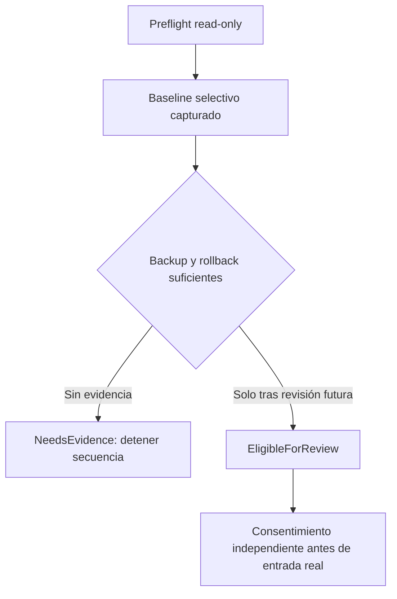

# LXMI 0.8.7 — ZZZ Game Prefix Entry Preflight

> Registro histórico de la revisión parcial. El bloqueo se cerró posteriormente en [0.8.7.1: backup y restore off-target](preflight_prefix_zzz_0_8_7.md), sin ejecutar nada dentro del prefix real.

Fecha: 2026-10-01. **READ-ONLY HOST / NEEDS EVIDENCE.** Se implementó y verificó el preflight, pero no alcanzó `EligibleForReview`. La secuencia se detiene aquí. Producto conserva **0.8.6**; 0.8.8 y 0.8.9 no comenzaron.

## Identidad y actividad — READ-ONLY HOST

Origen: discovery Steam/AppID 4162040, `stat`/canonicalización del prefix y servicio Tauri `inspect_zzz_prefix_preflight`. Prefix observado:

`~/.local/share/Steam/steamapps/compatdata/4162040/pfx`

| Campo | Evidencia |
|---|---|
| UID / owner | 1000 / usuario actual |
| Device / inode | 66306 / 11538172 |
| Relación | `pfx` bajo el compatdata detectado 4162040 |
| Estructura | drive_c, dosdevices, system.reg, user.reg, userdef.reg presentes |
| Actividad | Tauri: 0 coincidencias de juego/prefix, 0 procesos runtime sin resolver |
| Alcance | Snapshot puntual; no bloqueo del prefix ni garantía de inactividad futura |

El sandbox solo mostraba sus propios procesos. Ese scan no se usó como prueba de que el juego estuviese cerrado. Lectura del host aprobada: 192 procesos del mismo UID, 0 candidatos ejecutable ZZZ, 0 variables que apuntaran al compatdata real; 19 entornos inaccesibles de procesos generales. El backend distingue permisos no disponibles en procesos runtime de permisos en procesos ajenos al runtime. No se registran cmdlines completos ni entornos completos. Un runtime con entorno inaccesible permanece unresolved y no puede demostrar inactividad.

## Runtime drift — READ-ONLY HOST / LOCAL OBSERVED histórico

`Proton - Experimental/version` contiene:

`1790244902 experimental-11.0-20260924-x86_64`

Coincide con la observación 0.8.3: `SameBuild`. Se resuelve únicamente el candidato correspondiente a esa observación; no se usa la primera tool disponible ni otro Proton como fallback. Esto compara metadata de build, no autentica cada binario ni demuestra el commit exacto del Experimental. `GameRuntimePlan.selected` permanece separado/Unknown.

## Snapshot y paths protegidos — COMPROBADO

Policy schema 1: registro de identidad prefix; metadata seleccionada; SHA-256 de los tres registros (máximo 32 MiB por archivo); inventario superficial del prefix y dosdevices (máximo 256 entradas). No se recorre drive_c, documentos ni todo el juego. Las lecturas de hash rechazan symlinks finales, archivos fuera del límite y cambios de metadata/identidad durante la captura.

Paths protegidos derivados por backend: EXE y raíz del juego, appmanifest_4162040.acf, config/config.vdf, userdata y sus localconfig.vdf presentes (hasta 64 cuentas), roots de paquetes y runtimes LXMI. Los archivos pequeños se hashean; los directorios y archivos grandes solo tienen cobertura de metadata. Las raíces packages/runtimes no constituyen un hash de todo su contenido. No se afirma protección observacional de cada archivo interior. La acción disponible no posee ningún executor o destino de escritura en esos paths.

**READ-ONLY HOST:** baseline capturado desde ventana Tauri nativa:

`$XDG_DATA_HOME/lxmi/snapshots/zzz-prefix-b29ec9043ec169d3b62f231aff08f12c.json`

SHA-256: `417aa726417c7b251e3025af157592240b6dbcbbb2cfddc612ce1810fee9bffa`.

Manifest privado 0600; snapshots/root LXMI privados 0700 y owner actual. Contiene hashes/metadata, no valores de registry/configuración o secretos. Comparación posterior de los **15 paths seleccionados**: 0 diferencias en metadata/hashes observados. No equivale a un hash del juego/prefix completo ni atribuye mutaciones externas no cubiertas.

## Rollback — UNKNOWN / decisión de seguridad

| Alternativa | Evaluación |
|---|---|
| Copia completa | No realizada; tamaño total/cobertura y restauración coherente no demostrados. No se recorrió el prefix completo para estimarlo. |
| Copia de archivos críticos | Sería Partial; no cubre modificaciones/migraciones de drive_c. No existe restauración probada para el prefix real. |
| Reflink/snapshot | No demostrado. `statfs` informa ext2/ext3; ese dato no acredita soporte de snapshot/reflink. |
| Metadata/hashes | Implementado: MetadataOnly. Permite comparar, **no restaurar contenido**. |

Espacio libre observado: aproximadamente 63 GB; sin tamaño de backup demostrado no permite afirmar que sea suficiente para una copia completa.

La política previa `GamePrefixEntryRisk` de 0.8.6 exige backup y consentimiento. Este baseline **no satisface el requisito de backup**. No se exige que toda solución futura tenga rollback Full: podría revisarse una cobertura Partial con límites adecuados, pero aún no existe evidencia de restauración suficiente para este plan. El consentimiento tampoco convierte un hash en un backup.

## Investigación de mutaciones

Fuentes fijadas heredadas de 0.8.6: Wine wine-11.0 commit `db11d0fe6a169c457e23d007e20404643d067aa8`, Proton proton_10.0 commit `e91ca2be0df2cef4c230cbbc0b86604d73a0bbf6`. Se releyó el archivo Proton retenido `/tmp/lxmi-proton-pinned.py` cuyo SHA-256 sigue siendo `f07e19d289a4c7a1a9047bb123a2f630b54ceef1ee2ba0d96d1990a68055635e`. El fetch web fijado no estuvo disponible; no se presenta como una nueva verificación del commit exacto del Experimental instalado.

**UPSTREAM VERIFIED (source fijado retenido):** `init_session` establece WINEPREFIX desde compatdata; `runinprefix` llama `init_session(false)`, por lo que omite `setup_prefix` en esa ruta concreta. No corresponde afirmar que siempre ejecuta la migración completa. Antes del dispatch existen inicialización Wine, fixups y preparación de default prefix. El proceso Wine todavía puede producir escrituras normales. [Proton fijado](https://github.com/ValveSoftware/Proton/blob/e91ca2be0df2cef4c230cbbc0b86604d73a0bbf6/proton).

**LOCAL OBSERVED histórico:** 0.8.6 detectó cambios de registros y metadata en prefixes fixture. **Possible:** cambios de registry, mappings, locks, timestamps y metadata. **UNKNOWN:** lista exhaustiva, atribución y comportamiento exacto de una entrada del build Experimental en el prefix real. No se ejecutó para descubrirlo. La identidad endpoint Wine derivada de UID/dev/inode no acredita conexión efectiva al wineserver. [Fuente Wine fijada](https://github.com/wine-mirror/wine/blob/db11d0fe6a169c457e23d007e20404643d067aa8/server/request.c).

## Plan y gate — ARCHITECTURAL DECISION

`GamePrefixEntryPlan` es declarativo: helper inocuo de bridge, timeout 20 s, consentimiento futuro obligatorio, executor inexistente. El report incluye runtime/build, identidad, baseline, paths protegidos, mutaciones posibles, rollback y blockers. No se expone un comando de entry.

Mermaid conservado como fuente; no se afirma render validado. Resultado host: **NeedsEvidence**, blocker `rollback_insufficient_metadata_only`. Hook guard intacto, estrategia NoDecision, gate de juego cerrado. **0.8.8 / 0.8.9 NO COMPROBADO / no iniciados.**
