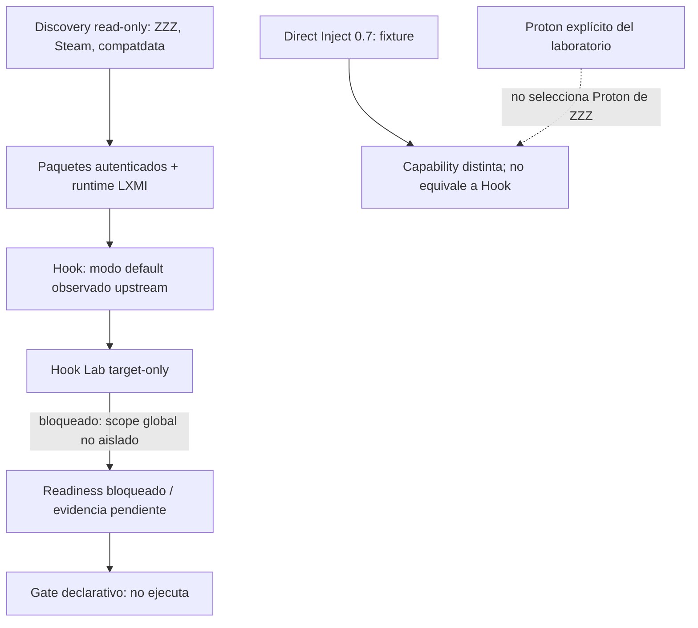

# LXMI 0.8 — readiness ZZMI / Steam / Linux

**Consulta:** 2026-09-28. La implementación se fija a XXMI Launcher v2.2.1, commit `d56786b8dacb00c35204bff45ff5b8b83bd8962a`. La wiki de launch modes son ejemplos de Windows; no verifican Linux/Proton.

## Qué significa Native Steam Launch upstream

La guía configura un Custom Launch de XXMI Launcher que invoca `steam.exe -applaunch 4162040`. El launcher prepara el modo loader y delega el inicio a Steam; Steam inicia ZZZ. La guía también muestra una Steam Launch Option que ejecuta directamente `ZenlessZoneZero.exe` con `%command%` para omitir HoYoPlay. Son ejemplos Windows con rutas `C:`.

**Direct Steam Launch** significa que el usuario pulsa Play en Steam y las launch options invocan primero `XXMI Launcher.exe`, encadenándolo luego con `%command%`. La página indica usar Native Steam Launch para ZZZ y que Direct Steam Launch de ZZZ se implementaría posteriormente.

Estos ejemplos no describen cómo traducir el flujo a Steam Linux + Proton. No sustituimos `steam.exe` por una ruta Linux ni presuponemos que LXMI nativo, un helper Windows y el proceso de juego compartan un contexto/prefix compatible.

## Estados de evidencia

| Capacidad | Estado en LXMI 0.8 | Evidencia / límite |
|---|---|---|
| Instalación Steam de ZZZ y AppID `4162040` | **COMPROBADO en discovery local anterior** | 0.8 no inicia el juego. |
| Ejecutable esperado `ZenlessZoneZero.exe` | **COMPROBADO en discovery local anterior** | Su presencia no prueba que el contenido esté completo. |
| compatdata y `pfx` de ZZZ | **COMPROBADO en el checkpoint local anterior; snapshot 0.8 pendiente** | El assessment vuelve a consultar el estado read-only; no abre ni modifica el prefix. |
| ZZMI y XXMI Libraries con autenticidad verificada | **COMPROBADO en el managed store anterior** | El assessment contrasta paquetes y runtime ensamblado actuales. |
| Mapeo del runtime LXMI a ruta Windows | **HOST TEST 0.6/0.7, contexto aislado** | No demuestra visibilidad desde proceso Steam-launched ZZZ. |
| Direct Inject en fixture bajo Proton | **HOST TEST 0.7** | Es distinto del modo default observado de ZZMI. |
| Hook bajo Proton | **BLOCKED / NO COMPROBADO** | La prueba target-only no puede aceptar un hook global sin evidencia de aislamiento. |
| Proton seleccionado por Steam para ZZZ | **UNKNOWN** | El Proton explícito del laboratorio es un concepto independiente. |
| Native Steam Launch ZZZ | **UPSTREAM DOCUMENTED** | La guía Windows muestra `steam.exe -applaunch 4162040`; no verifica Linux. |
| Direct Steam Launch ZZZ | **UPSTREAM PENDING** | La guía recomienda Native Steam Launch para ZZZ; no se tocan launch options ni Steam. |
| ZZZ Steam en Linux/Proton con ZZMI | **NO COMPROBADO** | El juego no se lanza. |
| Visibilidad Hook en contexto Steam y requisito same-prefix | **UNKNOWN** | No se prueba contra ZZZ ni se deduce desde Direct Inject. |
| Compatibilidad de loader específica de ZZZ | **NO COMPROBADO** | El laboratorio usa procesos LXMI únicamente. |

## Readiness y gate

`ZzmiLaunchReadiness` representa por separado juego/distribución/instalación/ejecutable, compatdata/prefix, autenticidad de paquetes, runtime ensamblado, Proton seleccionado para el juego, Proton candidates, runtime explícito de laboratorio, loader mode, capacidades, requisitos, blockers y unknowns. `selected_game_runtime` nunca hereda `explicit_lab_runtime`.

El modo de la configuración ZZMI examinada es Hook. La ejecución Hook aislada está bloqueada por el límite de proceso y siguen desconocidos el contexto Steam/Proton, same-prefix y compatibilidad específica; el resultado no autoriza el primer experimento controlado con ZZZ. El gate es declarativo, nunca lanza el juego, y un futuro flujo requeriría consentimiento separado.

## Requisito previo a una futura fase

Antes de autorizar una ejecución ZZZ, LXMI necesita una prueba segura y revisable sobre aislamiento Hook bajo Wine/Proton, visibilidad entre procesos/contextos, runtime que Steam asigna al juego, secuencia Native Steam Launch equivalente y límites de plataforma. No usar Direct Inject como sustituto automático del Hook default. Cualquier ruta que requiera evadir, deshabilitar o interferir con anti-cheat queda fuera del proyecto.

## Fuentes

- [XXMI Launcher v2.2.1 fijado](https://github.com/SpectrumQT/XXMI-Launcher/tree/d56786b8dacb00c35204bff45ff5b8b83bd8962a)
- [`migoto_package.py` fijado](https://github.com/SpectrumQT/XXMI-Launcher/blob/d56786b8dacb00c35204bff45ff5b8b83bd8962a/src/xxmi_launcher/core/packages/migoto_package.py)
- [`dll_injector.py` fijado](https://github.com/SpectrumQT/XXMI-Launcher/blob/d56786b8dacb00c35204bff45ff5b8b83bd8962a/src/xxmi_launcher/core/utils/dll_injector.py)
- [Wiki upstream: More Start Options](https://github.com/SpectrumQT/XXMI-Launcher/wiki/More-Start-Options)
- [ZZMI `d3dx.ini` en release v1.5.0 fijada](https://github.com/leotorrez/ZZMI-Package/blob/e59f87047cd405c5db5476d3b1b499574bc43d67/ZZMI/d3dx.ini)
