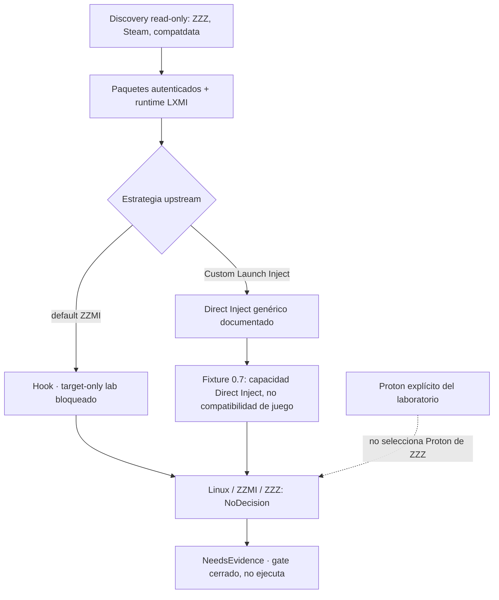

# LXMI 0.8 — readiness ZZMI / Steam / Linux

**Consulta:** 2026-09-28. La implementación se fija a XXMI Launcher v2.2.1, commit `d56786b8dacb00c35204bff45ff5b8b83bd8962a`. La wiki de launch modes son ejemplos de Windows; no verifican Linux/Proton.

## Qué significa Native Steam Launch upstream

La guía configura un Custom Launch de XXMI Launcher que invoca `steam.exe -applaunch 4162040`. El launcher prepara el modo loader y delega el inicio a Steam; Steam inicia ZZZ. La guía también muestra una Steam Launch Option que ejecuta directamente `ZenlessZoneZero.exe` con `%command%` para omitir HoYoPlay. Son ejemplos Windows con rutas `C:`.

**Direct Steam Launch** significa que el usuario pulsa Play en Steam y las launch options invocan primero `XXMI Launcher.exe`, encadenándolo luego con `%command%`. La página indica usar Native Steam Launch para ZZZ y que Direct Steam Launch de ZZZ se implementaría posteriormente.

Estos ejemplos no describen cómo traducir el flujo a Steam Linux + Proton. No sustituimos `steam.exe` por una ruta Linux ni presuponemos que LXMI nativo, un helper Windows y el proceso de juego compartan un contexto/prefix compatible.

## Estados de evidencia

| Capacidad | Estado en LXMI 0.8 | Evidencia / límite |
|---|---|---|
| Instalación Steam de ZZZ y AppID `4162040` | **COMPROBADO en discovery local anterior** | 0.8 no inicia el juego. |
| Ejecutable esperado `ZenlessZoneZero.exe` | **COMPROBADO en discovery local anterior** | Su presencia no prueba que el contenido esté completo. |
| compatdata y `pfx` de ZZZ | **COMPROBADO en el checkpoint local anterior; snapshot 0.8 pendiente** | El assessment vuelve a consultar el estado read-only; no abre ni modifica el prefix. |
| ZZMI y XXMI Libraries con autenticidad verificada | **COMPROBADO en el managed store anterior** | El assessment contrasta paquetes y runtime ensamblado actuales. |
| Mapeo del runtime LXMI a ruta Windows | **HOST TEST 0.6/0.7, contexto aislado** | No demuestra visibilidad desde proceso Steam-launched ZZZ. |
| Direct Inject en fixture bajo Proton | **HOST TEST 0.7** | Es distinto del modo default observado de ZZMI. |
| Hook bajo Proton | **BLOCKED / NO COMPROBADO** | La prueba target-only no puede aceptar un hook global sin evidencia de aislamiento. |
| Proton seleccionado por Steam para ZZZ | **UNKNOWN** | El Proton explícito del laboratorio es un concepto independiente. |
| Native Steam Launch ZZZ | **UPSTREAM DOCUMENTED** | La guía Windows muestra `steam.exe -applaunch 4162040`; no verifica Linux. |
| Direct Steam Launch ZZZ | **UPSTREAM PENDING** | La guía recomienda Native Steam Launch para ZZZ; no se tocan launch options ni Steam. |
| ZZZ Steam en Linux/Proton con ZZMI | **NO COMPROBADO** | El juego no se lanza. |
| Visibilidad Hook en contexto Steam y requisito same-prefix | **UNKNOWN** | No se prueba contra ZZZ ni se deduce desde Direct Inject. |
| Compatibilidad de loader específica de ZZZ | **NO COMPROBADO** | El laboratorio usa procesos LXMI únicamente. |

## Readiness y gate observados en LXMI 0.8 (histórico)

`ZzmiLaunchReadiness` representa por separado juego/distribución/instalación/ejecutable, compatdata/prefix, autenticidad de paquetes, runtime ensamblado, Proton seleccionado para el juego, Proton candidates, runtime explícito de laboratorio, loader mode, capacidades, requisitos, blockers y unknowns. `selected_game_runtime` nunca hereda `explicit_lab_runtime`.

En LXMI 0.8 el modo default ZZMI examinado era Hook y el readiness quedaba bloqueado/no concluyente. La reevaluación 0.8.1 trazó también la ruta upstream Direct Inject para Custom Launch: el Hook no queda establecido como requisito exclusivo, pero tampoco se afirma compatibilidad de Direct Inject con ZZMI/ZZZ/Linux/Proton. El estado vigente es `NeedsEvidence`, estrategia preferida `NoDecision`, game Proton `Unknown` y gate cerrado. El gate es declarativo, nunca lanza el juego, y un futuro flujo requeriría consentimiento separado. Véase [`estrategia_loader_zzmi_linux.md`](estrategia_loader_zzmi_linux.md) y la [verificación 0.8.1](../06_Verificacion/verificacion_0_8.md#lxmi-081).

## Reassessment 0.8.1

| Dato | Estado vigente |
|---|---|
| Default de `use_hook` en `ModelImporterPackage` | `true`; ZZMI lo hereda. **UPSTREAM VERIFIED** |
| `custom_launch_inject_mode` | Solo cambia `use_hook` si Custom Launch está activo; `Hook` mantiene Hook, `Inject` habilita ruta Direct Inject, `Bypass` omite `d3d11.dll` por default. **UPSTREAM VERIFIED** |
| Direct Inject upstream | Ruta genérica `MigotoInjector` con `3dmloader.dll`, proceso iniciado y detectado por nombre/PID dentro del timeout. **UPSTREAM VERIFIED** |
| Hook exclusivo requerido por ZZMI | `NotEstablished`; no se halló una restricción técnica Hook-only. Esto no demuestra que Hook no sea necesario. |
| Hook bajo Proton | No ejecutado; su modelo Wine es desktop-scoped dentro de server/sesión según fuente Wine consultada. **UNKNOWN para Proton/3dmloader**; el guard sigue activo. |
| Same prefix / wineserver | **UNKNOWN** para la combinación ZZZ + Steam + Proton + loader. Prefixes distintos pueden formar sesiones Wine independientes, pero esto no verifica el caso Proton. |
| Direct Inject Linux/ZZZ | Candidato de investigación por el fixture 0.7 y la ruta upstream; compatibilidad de juego sigue **UNKNOWN**. |
| Readiness y gate | `NeedsEvidence`, `NoDecision`, game Proton `Unknown`; no elegible y sin ejecución. |

## Evidencia de contexto 0.8.2

La inspección local de `config/config.vdf` no encontró entrada por AppID `4162040` ni default global bajo `CompatToolMapping`; las referencias consultadas de `localconfig.vdf` tampoco contenían esa clave. Proton Experimental está instalado, pero no se convierte en runtime seleccionado. Manifest, executable, `compatdata/4162040` y `pfx` están presentes como evidencia filesystem. El runtime efectivo, prefix/wineserver activos y requisitos de contexto del loader permanecen `Unknown`; readiness sigue `NeedsEvidence` y el gate continúa cerrado. Ver [evidencia Steam/Proton 0.8.2](evidencia_contexto_steam_proton_0_8_2.md) y [verificación](../06_Verificacion/verificacion_0_8_2.md).

## Requisito previo a una futura fase

Antes de autorizar una ejecución ZZZ, LXMI debe escoger una estrategia específica con evidencia para esa ruta y cerrar los unknowns de proceso/runtime Steam-Proton, selección de Proton, identificación/espera del target y límites de plataforma. Si se considerara Hook, su alcance seguro tendría que demostrarse antes de cualquier ejecución; Direct Inject tampoco queda aprobado por el éxito del fixture. Cualquier ruta que requiera evadir, deshabilitar o interferir con anti-cheat queda fuera del proyecto.

## Fuentes

- [XXMI Launcher v2.2.1 fijado](https://github.com/SpectrumQT/XXMI-Launcher/tree/d56786b8dacb00c35204bff45ff5b8b83bd8962a)
- [`migoto_package.py` fijado](https://github.com/SpectrumQT/XXMI-Launcher/blob/d56786b8dacb00c35204bff45ff5b8b83bd8962a/src/xxmi_launcher/core/packages/migoto_package.py)
- [`dll_injector.py` fijado](https://github.com/SpectrumQT/XXMI-Launcher/blob/d56786b8dacb00c35204bff45ff5b8b83bd8962a/src/xxmi_launcher/core/utils/dll_injector.py)
- [Wiki upstream: More Start Options](https://github.com/SpectrumQT/XXMI-Launcher/wiki/More-Start-Options)
- [ZZMI `d3dx.ini` en release v1.5.0 fijada](https://github.com/leotorrez/ZZMI-Package/blob/e59f87047cd405c5db5476d3b1b499574bc43d67/ZZMI/d3dx.ini)
