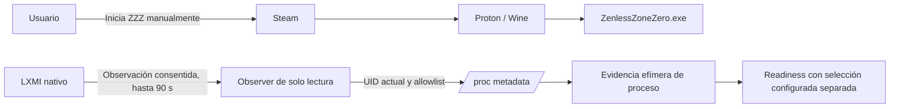

# Observación pasiva del runtime Steam/Proton de ZZZ — LXMI 0.8.3

**Fecha de implementación:** 2026-09-30  
**Juego objetivo:** Zenless Zone Zero, Steam AppID `4162040`  
**Estado de observación:** hay una validación local nueva documentada abajo. El resultado de la sesión previa sigue **UNKNOWN**; no se recuperó su snapshot.

## Pregunta

¿Qué contexto Steam/Proton expone el sistema operativo durante una ejecución normal de ZZZ, sin que LXMI inicie o controle el juego?

La respuesta se recoge por sesión. No modifica la selección persistente/configurada ni demuestra compatibilidad de ZZMI.

## Límite de responsabilidad

El observer no crea procesos externos ni tiene operaciones de señal/control. No lee `/proc/<pid>/mem`, no usa `ptrace`, debugger, `process_vm_readv`, ni herramientas de tracing attach. No inspecciona anti-cheat.

## Evidencia que recoge

- Identidad de proceso: nombre ejecutable esperado (`ZenlessZoneZero.exe` o variante registrada), path de instalación detectado cuando está disponible, y señales adicionales AppID/compatdata/ascendencia Steam. El nombre aislado no basta.
- El scan inicial ocurre antes del primer intervalo de espera. El nombre puede encontrarse en `comm`, `/proc/<pid>/exe` o argumentos; un `/proc/<pid>/exe` con nombre Wine/preloader no invalida por sí solo un `cmdline` que identifique el ejecutable esperado.
- Cada scan devuelve contadores acotados: procesos del UID indexados, candidatos revisados, fallos de metadatos, rechazos por nombre/evidencia insuficiente y matches aceptados. No devuelve listas generales ni command lines.
- UID del proceso: debe coincidir con el UID efectivo del usuario actual, comprobado mediante metadata de `/proc/<pid>` y `Uid` de `status`.
- Relación de procesos: ascendencia limitada y filtrada a Steam, pressure-vessel, Proton, Wine y el juego. La UI no muestra una lista general de procesos.
- Environment allowlist exacta: `STEAM_COMPAT_APP_ID`, `SteamAppId`, `SteamGameId`, `STEAM_COMPAT_DATA_PATH` y `WINEPREFIX`. No se guarda ni devuelve el environment completo.
- Proton observado: solo se asocia a una herramienta instalada válida cuando el path de ejecutable/argv de un proceso relacionado coincide con su root. Instalación, orden, versión reciente y runtime de laboratorio no son evidencia de ejecución.
- La lectura fallida de `environ` distingue `PermissionDenied` de otras causas `Unavailable`; el proceso aún puede identificarse mediante señales independientes. Ninguno de esos estados se presenta como ausencia confirmada de una variable.
- wineserver: se inspeccionan únicamente procesos del UID actual cuyo nombre corresponde a wineserver. Un `WINEPREFIX` coincidente se informa como evidencia de variable compartida; no prueba qué endpoint/instancia de wineserver usa el juego.

Las lecturas tienen límites por archivo, el PID se vuelve a comprobar mediante `starttime` para reducir carreras de reutilización, el muestreo ocurre cada segundo y la sesión termina al detenerla, desaparecer un proceso observado o alcanzar 90 segundos. La evidencia vive en memoria y no se persiste.

## Estados preservados

| Hecho | Estados principales |
|---|---|
| AppID de entorno | `Verified`, `Conflicting`, `NotObserved`, `Unavailable`, `PermissionDenied` |
| compatdata efectivo | `ObservedAndMatches`, `ObservedDifferent`, `Conflicting`, `NotObserved` |
| prefix | `Observed`, `DerivedFromObservedCompatdata`, `Unknown`, `Ambiguous` |
| Proton del proceso | `Verified` (tool observada), `Ambiguous`, `Unknown` |
| wineserver | `ObservedAndMatches`, `Unknown`, `NotObserved`, `Ambiguous`, `Unavailable` |
| proceso | `WaitingForGame`, `Observed`, `Completed`, `ProcessNotFound`, `AmbiguousProcess`, `ProcessExited`, `TimedOut`, `BackendError` |

`DerivedFromObservedCompatdata` significa solamente `STEAM_COMPAT_DATA_PATH/pfx` según la convención Proton; no se presenta como lectura directa de `WINEPREFIX`. Un wineserver con la misma variable no convierte el requisito same-wineserver del loader en conocido.

## Configuración, observación y candidates

- **Configuración:** mapping por AppID y mapping global se leen de la fuente Steam ya inspeccionada por LXMI. Si no existe override en esa fuente, se informa esa ausencia acotada; no se predice el resultado efectivo.
- **Observación:** describe una única sesión iniciada manualmente. Aunque observe Proton Experimental, no cambia la configuración ni `GameRuntimePlan.selected`.
- **Disponibilidad:** lista tools Proton detectadas, separada de configuración y observación.

Readiness puede incorporar el resumen efímero. `GameRuntimePlan.selected` se conserva `Unknown`; Loader Strategy sigue `NoDecision`; requisitos same-prefix/same-wineserver y compatibilidad ZZMI/ZZZ siguen sin resolverse. El gate no recibe executor ni autoriza un lanzamiento.

## Hallazgos locales previos, no sustituyen una observación

- **LOCAL VERIFIED, 0.8.2:** manifest Steam `4162040`, ejecutable detectado y `compatdata/4162040/pfx` candidato presentes.
- **LOCAL VERIFIED, 0.8.2:** Proton Experimental está instalado; `config/config.vdf` no contenía mapping por AppID en la sección consultada.
- **LOCAL OBSERVED, 0.8.3:** para la sesión observada, Proton Experimental, AppID `4162040`, compatdata y prefix fueron identificados por metadata de proceso.
- **UNKNOWN:** qué instancia de wineserver usa efectivamente ZZZ y qué contexto necesitaría compartir un loader futuro.
- **NO COMPROBADO:** compatibilidad ZZMI/ZZZ/Linux/Proton, ejecución del loader, Hook, Direct Inject contra el juego y la necesidad de same-prefix/same-wineserver.

## Diagnóstico de la sesión manual anterior

- **LOCAL OBSERVED (reportado por el usuario):** ZZZ ya estaba abierto en el lobby cuando pulsó Observe desde la ventana Tauri; el juego continuó ejecutándose.
- **LOCAL OBSERVED:** los logs de esa sesión registran `Passive runtime observation started` y `Passive runtime observation completed` con aproximadamente 91 segundos entre ambos. La versión previa no registraba scans, candidatos, estado terminal ni el snapshot devuelto.
- **COMPROBADO por inspección estática:** el command Tauri devuelve `RuntimeObservationSnapshot`, no `Ok(())`; React conserva el snapshot durante el montaje del panel y consulta el command de estado mientras la sesión está activa. El observer hace un scan al iniciar, antes de esperar el siguiente segundo.
- **COMPROBADO:** antes del arreglo, el resultado solo se renderizaba dentro de un `
` plegable. La extracción que contenía solo sus resúmenes es compatible con que estuviera cerrado; no demuestra que el backend no encontrara ZZZ ni que la llamada Tauri fallara.
- **UNKNOWN:** si el scan anterior encontró ZZZ, produjo ambigüedad o encontró permisos denegados; qué snapshot final generó; y si el polling Tauri recibió ese resultado. Los logs anteriores no separan esos casos.
- **LOCAL OBSERVED (snapshot posterior, 2026-09-30):** una inspección read-only actual de `/proc` no encontró un proceso del UID actual con señales `ZenlessZoneZero`; describe solo el instante consultado y no contradice la sesión reportada anteriormente.

El cambio corrigió la falta de visibilidad y agregó evidencia agregada sin command lines ni entorno completo. La validación manual nueva aparece a continuación.

## Validación manual completada — 2026-09-30, hora local

El usuario compartió la salida de la ventana Tauri nativa y su terminal `npm run tauri:dev`.

- **LOCAL OBSERVED:** sesión 1, `Observed`, activa a los 67 segundos; proceso `ZenlessZoneZero.exe`, PID `691954`.
- **LOCAL OBSERVED:** primer scan a `00:52:17Z`: `WaitingForGame`, 191 procesos del usuario y cero candidatos. A `00:52:42Z`: `Observed`, 215 procesos, cuatro candidatos y uno aceptado; scans posteriores conservaron un match. Esto comprueba detección durante la ventana de observación. No se infiere que ZZZ ya existiera en el primer scan.
- **LOCAL OBSERVED:** AppID `4162040`, estado verificado; señales de identidad incluyeron nombre esperado, AppID y compatdata coincidentes y ascendencia relacionada con Steam.
- **LOCAL OBSERVED:** Proton `Proton - Experimental`, internal ID `1790244902`, build `experimental-11.0-20260924-x86_64`; el path ejecutable/argv asociado coincidió con el root de una tool Proton instalada válida.
- **LOCAL OBSERVED:** compatdata `~/.local/share/Steam/steamapps/compatdata/4162040`, observado y coincidente; prefix `~/.local/share/Steam/steamapps/compatdata/4162040/pfx/`, observado.
- **LOCAL OBSERVED:** un proceso wineserver del UID actual reportó `WINEPREFIX` coincidente. La UI advierte que esto no demuestra que ZZZ se comunique con esa instancia.
- **LOCAL OBSERVED:** la fuente Steam inspeccionada no contenía mapping por AppID; el default global se mostró por separado. La herramienta observada es evidencia de esa ejecución, no selección configurada ni `GameRuntimePlan.selected`.
- **INFERIDO:** la UI reportó `environ` denegado y el contador directo mostró cero candidatos denegados. El estado de entorno de un match agrega proceso y ascendencia, mientras el contador original cubría lecturas directas. No se identificó el PID concreto cuya lectura fue denegada. La UI y los contadores se ajustaron para exponer esos alcances separados.
- **LOCAL OBSERVED:** el snapshot se capturó activo a los 67 segundos. La evidencia suministrada no incluye su estado terminal luego del límite de 90 segundos; ese estado queda **UNKNOWN**.
- **NO COMPROBADO:** la salida compartida no incluye una captura posterior a pulsar “Re-evaluar readiness”. La conexión de readiness está cubierta por tests, y la selección del planner permanece separada.
- **NO COMPROBADO:** comparación de hash pre/post del filesystem del juego/Steam/prefix. El observer y el flujo Tauri recorrido no ofrecen ni invocan escrituras sobre esas ubicaciones.

No se ejecutaron Hook, Direct Inject, Proton de laboratorio, bridge helper ni loader. Esta evidencia no demuestra compatibilidad ZZMI/ZZZ bajo Linux/Proton, requisito same-prefix/same-wineserver ni compatibilidad del loader.
