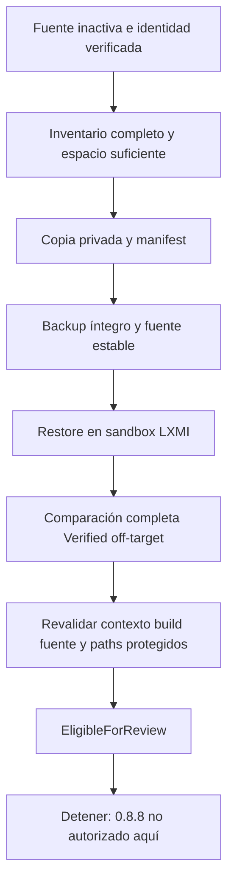

# LXMI 0.8.7 — Prefix Backup & Restore Qualification

Fecha: 2026-10-01. **COMPROBADO / HOST TEST:** el bloqueo MetadataOnly se cierra mediante backup recuperable y restore independiente. Preflight **ELIGIBLE FOR REVIEW**; versión 0.8.7. **No se inicia 0.8.8, 0.8.9 ni 0.9.** La investigación original parcial permanece en [registro histórico](game_prefix_entry_preflight_0_8_7.md).

## READ-ONLY SOURCE — identidad y actividad

Fuente: discovery Steam/AppID 4162040, preflight Tauri y ProcfsObserver same-UID. Canonical prefix `~/.local/share/Steam/steamapps/compatdata/4162040/pfx`, UID1000, device66306, inode11538172. Se revalidó contra el preflight inmediatamente antes de la captura; la lectura inicial del host y las comprobaciones backend no detectaron juego/contexto asociado ni runtime unresolved. Son comprobaciones puntuales, no un lock atómico del prefix.

Build observado/metadata instalada: `1790244902 experimental-11.0-20260924-x86_64`, SameBuild. No se ejecutó Proton para verificarlo y no se convierte en GameRuntimePlan.selected. LoaderStrategyDecision continúa NoDecision y el gate de juego cerrado.

## Estrategia — ARCHITECTURAL DECISION

| Alternativa | Evaluación |
|---|---|
| Copia recursiva preservando metadata | Elegida: estructura visible para verificación independiente, sin extracción de un archivo ni dereference de symlinks. FD por cada directorio, O_NOFOLLOW y destinos nuevos. |
| Reflink | No demostrado en este host; no se necesita ni se asume ahorro físico. No se prueba sobre la fuente. |
| Archivo tar | GNU tar 1.35 está disponible y puede conservar atributos; requeriría política de archivo/extracción adicional. No se usa ni ejecuta. |

La referencia GNU documenta permisos, timestamps y atributos, y los riesgos de seguir symlinks en extracción. [GNU tar Attributes](https://www.gnu.org/s/tar/manual/html_section/Attributes.html), [GNU tar formats](https://www.gnu.org/software/tar/manual/html_chapter/Formats.html). El diseño propio usa operaciones Linux de archivo/descriptor; no invoca shell ni cp. [stat/fstatat](https://man7.org/linux/man-pages/man2/stat.2.html), [symlink y O_NOFOLLOW](https://man7.org/linux/man-pages/man7/symlink.7.html).

## Scope y metadata soportada

Se cubren **todas las entradas del árbol pfx**: archivos regulares, directorios, symlinks (incluidos dosdevices). Nunca se siguen targets externos, ni se copia el juego por los mappings. Se preservan UID/GID del usuario, mode, mtime nanosegundo, targets de enlaces y xattrs de archivos/directorios (incluidos ACLs si pueden conservarse). Los valores xattr no se incluyen en el manifiesto: solo nombre/hash. Fuente host: 0 entradas con xattrs; preservación probada con fixture.

Se rechazan sockets, FIFOs, dispositivos, mounts con device distinto, owners ajenos, nombres no UTF-8, metadata no preservable y xattrs de symlinks. No se omiten silenciosamente. Límite 100000 entradas, profundidad64, archivo8GiB, total lógico32GiB, manifest64MiB y timeout600s por operación. Buffer de copia/hash128KiB, xattrs agregados limitados a1MiB por entrada.

**Límites explícitos:** inodes, ctime/birthtime, sparse allocation y topología de hardlinks no se restauran. Hardlinks se expanden en copias independientes; su contenido, modo, grupo, mtime/xattrs sí se verifican. Atime no forma parte de la comparación ni de restauración: lecturas regulares/directorios usan O_NOATIME; readlink puede tener efectos normales de access time. No se hacen syscalls de escritura sobre la fuente. La consistencia declarada cubre contenido, estructura y metadata de la política, no todos los cambios de atime. La copia no es un prefix autónomo ejecutado: los targets de symlinks externos siguen dependiendo de su entorno.

## Backup — VERIFIED

ID: `f3551122468ed68b825a0182922f3be2`.

`$XDG_DATA_HOME/lxmi/backups/zenless-zone-zero/prefix/f3551122468ed68b825a0182922f3be2/`

Incluye tree/, manifest.json y manifest-sha256.json. Manifest schema1: ID, fecha, AppID/game, identidad canonical de fuente, build, estrategia, política, tamaños y entradas relativas con tipo/size/mode/UID/GID/mtime/target/hash. No contiene PIDs ni contenido de registros/documentos. Envelope privado0700; manifests0600. El árbol interior conserva permisos de fuente y queda protegido por el envelope privado.

SHA-256 del manifiesto: `db1d884b02ede5435f64520b92fcddf9e4688d56701c1329536d9abe38fa155f`.

**HOST TEST:** 783 archivos, 285 directorios, 1377 symlinks =2445 entradas incluyendo raíz. 2445 matching entries; 783 file hashes matching; 0 mismatches, 0 unsupported metadata. SHA recalculado coincide. Integrity no equivale a autenticidad upstream ni protección contra un atacante con el mismo UID que alterase coherentemente toda la evidencia.

Staging `<id>.tmp`, ID aleatorio nuevo, creación exclusiva y rename atómico sin reemplazo solo tras verificación y consistencia. Fallos se limpian únicamente en staging propio; ningún staging se acepta como Verified. Los backups finalizados no se sobrescriben por API. La inmutabilidad es de política; modificaciones externas se detectan en re-verificación, no se afirma filesystem immutable. El journal de evidencia es separado, bajo snapshots/.

## Consistencia de fuente y paths protegidos

Inventarios completos before/after comparan bytes, estructura y metadata soportada, más device/inode/ctime de fuente por entrada durante captura. Se rechaza source changed. Readiness posterior vuelve a verificar backup, restore y fuente actual antes de usar evidencia; no basta una carpeta existente o un journal que diga Verified.

**READ-ONLY SOURCE:** identidad estable; contenido/estructura/metadata soportada sin diferencias durante captura y en reevaluación. Los paths protegidos selectivos del preflight se compararon antes/después: sin diferencias observadas. No se atribuye ausencia de cambios a todo Steam/game tree, solo a la cobertura seleccionada. El backup completo tampoco cubre el parent compatdata, estado global Steam/Proton o targets externos de symlinks.

## Restore — VERIFIED OFF-TARGET

`$XDG_DATA_HOME/lxmi/restore-tests/f3551122468ed68b825a0182922f3be2/tree/`

Destino fresco privado, derivado exclusivamente de ID backend; no acepta destination frontend. Se copió desde backup, no desde fuente. 2445 entradas y 783 archivos coinciden; sin entradas inesperadas, hashes/targets/metadata discrepantes o unsupported metadata. Backup se re-verifica antes del restore; se rechaza tampering. No se ejecutó Wine ni se reutilizó este sandbox como prefix runtime.

**RealPrefixRestore: NOT TESTED ON REAL PREFIX.** GamePrefixRestorePlan es declarativo: destination exacto esperado, juego/contexto inactivos, identidad revalidada, backup Verified, confirmación explícita y paths protegidos obligatorios. `real_target_executor_available=false`. No hay botón/API de restauración real.

## Coste de almacenamiento — HOST TEST

| Campo | Bytes |
|---|---:|
| Fuente lógica (archivos regulares) | 434316729 |
| Fuente asignada (inodes únicos + dirs/enlaces) | 436322304 |
| Backup lógico | 434316729 |
| Backup asignado | 442859520 |
| Libre antes | 62867013632 |
| Libre después de backup y restore | 61978664960 |

La variación global de espacio no es contabilidad exclusiva LXMI: hubo builds concurrentes. El gate requiere espacio para 2x tamaño lógico +256MiB, y fallos de I/O no producen Verified. Un backup por review session; IDs nunca se sobrescriben. Política futura: últimos2 más activo protegido, cleanup manual; sin gestión/deletion automática actual.

## Reassessment — ELIGIBLE FOR REVIEW

Mermaid como fuente, sin afirmar render validado. La política considera full-tree backup de scope pfx + restore off-target + fuente consistente suficientes **para revisión** de la futura prueba de helper inocuo. No exige un restore real destructivo para obtener esa evidencia. `RecoverableBackupVerifiedOffTarget` distingue potencial recuperación demostrada fuera del target de rollback real no probado. No resuelve reversión de efectos fuera de pfx, procesos/locks activos, joins con el juego ni compatibilidad ZZMI.

Tauri mostró EligibleForReview, mismo build, actividad0/0 y rollback RecoverableBackupVerifiedOffTarget. `execution_authorized=false`, entry executor inexistente, consentimiento futuro obligatorio. **0.8.7 cerrado; versión0.8.7; detener.**
