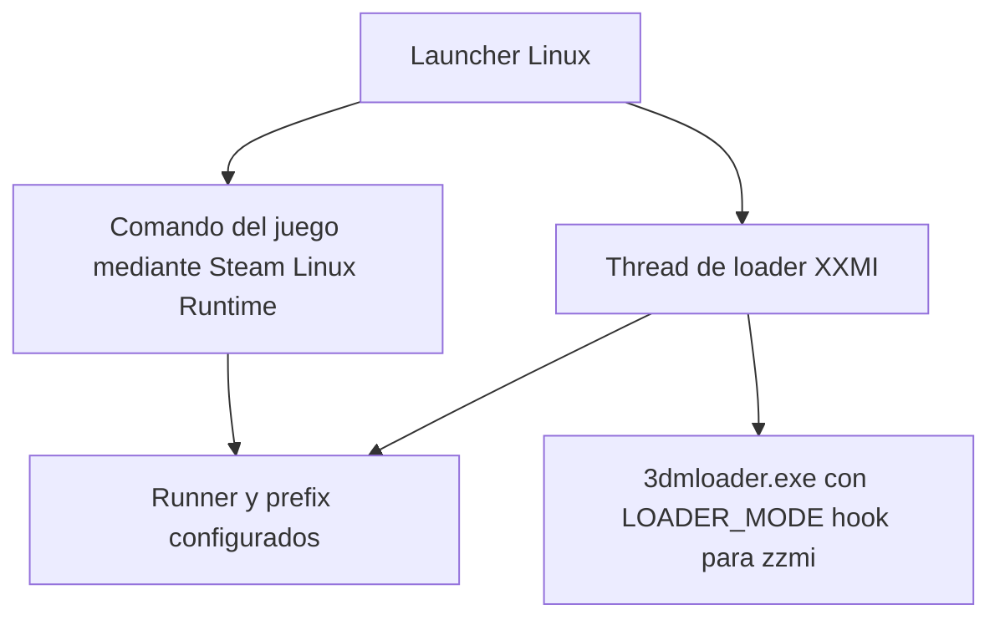

# TwintailLauncher y diagnóstico del blocker LXMI0.8.8

Fecha2026-10-02 UTC /2026-10-01 America/La_Paz. Trabajo autorizado de investigación y diagnóstico posterior a UnexpectedMutation. Versión0.8.7. No nueva entrada al prefix, no0.8.9/0.9, ni cambio de guard/consent/backup.

## UPSTREAM VERIFIED — Twintail fijado

| Campo | Evidencia |
|---|---|
| Repository | https://github.com/TwintailTeam/TwintailLauncher |
| Branch consultado | stable, fijado al commit descargado |
| Commit | 97d626e76e5eb0bc01361e8788d3a23133c38429 |
| Commit date | 2026-10-02T00:55:52Z |
| Package version |2.5.1 en package.json y src-tauri/Cargo.toml; no se afirma release/tag2.5.1 |
| License source |LICENSE contiene GPLv3; no se copiaron implementaciones ni distribuyeron binaries |
| Source cache | /tmp/lxmi-twintail-review; git clone para inspección, sin build/run |

Archivos inspeccionados: README.md, LICENSE, package.json, Cargo.toml/Cargo.lock, src-tauri/src/utils/game_launch_manager.rs y mapping get_mi_path_from_game en utils/mod.rs. Dependencia fischl fijada en lock a b7f534d4a93310135d00db1fac7949b9d0f7a37d; su implementación no se auditó/ejecutó. Licencia de source no atribuye automáticamente procedencia/licencia de DLLs descargadas.

### Flujo relevante, límites

[get_mi_path_from_game](https://github.com/TwintailTeam/TwintailLauncher/blob/97d626e76e5eb0bc01361e8788d3a23133c38429/src-tauri/src/utils/mod.rs#L185): basename lowercase ZenlessZoneZero.exe se mapea a zzmi. [load_xxmi](https://github.com/TwintailTeam/TwintailLauncher/blob/97d626e76e5eb0bc01361e8788d3a23133c38429/src-tauri/src/utils/game_launch_manager.rs#L302): invoca 3dmloader.exe con importer subdirectory; configura LOADER_MODE inject para efmi/wwmi y hook para los demás, incluido zzmi. No demuestra Direct Inject con ZZMI, ni aislamiento de Hook. LXMI conserva NoDecision y hook guard.

Game/loader reciben mismo runner_prefix y WINEPREFIX=<prefix>/pfx; el game path incluye Steam Linux Runtime _v2-entry-point, mientras la función Linux load_xxmi usa runner directo en thread. La llamada a load_xxmi ocurre antes de spawn del game command, pero el thread asíncrono no prueba que Hook esté preparado antes de que aparezca el target.

Este diagrama describe el source, no un HOST TEST ni una recomendación de ejecutar su loader. No se renderizó el Mermaid.

Útil para LXMI: separar runner, prefix, entorno Linux/container y lifecycle. **No reusable directamente:** shell/pre-launch/env arbitrarios, inicialización/tweaks/patches de instalación, winetricks, kill global por nombres y políticas de overrides. No se inspeccionan métodos de evasión ni se adopta ninguna técnica fuera de los límites LXMI. No se instala Twintail, no se cambia Steam ni se copia código GPL al proyecto.

## READ-ONLY HOST — diff exacto del intento

Antes de inferir cambios se verificó: bytes de system.reg/user.reg/userdef.reg del backup f3551122468ed68b825a0182922f3be2 coinciden exactamente con before hashes de sesión699f4768f21d30842653eb404baeb237. Bytes actuales coinciden con after hashes. A diferencia del caso localconfig histórico, aquí sí existe contenido before válido en el backup. No se restaura ni sobrescribe backup. Lectura regular same UID O_NOFOLLOW/O_NOATIME con límite8MiB y metadata stable check.

Recibo final SHA `1f2b3d6e7bdaecdc15f14a40a1ebfd3ddae62a387e493f6cfa1ce802fc9da246`, validado antes del diagnóstico. Registro before/after en memoria solamente; resultado agregado sin valores, nombres de fuentes, GUIDs de dispositivos o registry dumps.

| Hive / semantic category | Resultado |
|---|---|
| system.reg |7 secciones cambiadas:2 Fonts,4 device ContainerId,1 NetworkCards vacía removida |
| user.reg |1 sección cambiada:Wine/Fonts/External Fonts |
| userdef.reg |0 cambios semánticos/content, metadata sí cambiada en host test |
| Cada una de las3 tablas Fonts |135 nuevas entradas,368 modificadas,0 removidas |
| Cada tabla,368 modificaciones |mismo filename; ruta Z:\run\host\… pasa a Z:\usr\share\fonts\… |
| Dispositivos |2 HID y2 WINEBUS; único value cambiado ContainerId, valores/GUIDs redactados |
| NetworkCards |clave antes vacía, ausente después; causa UNKNOWN |
| dosdevices |32 symlinks COM recreados (inode/mtime), targets observados iguales; c:/s:/z: iguales |
| Protected paths |9 registros sin diferencias en snapshot policy; no cobertura whole-disk |

Las3 tablas contienen entradas relacionadas: no son1104 archivos de fuentes distintos por sumar368 tres veces. UnknownSections=0 indica que el diagnóstico identifica categorías; **no** que sus cambios estén aprobados/seguros o que un escritor esté demostrado.

## Fuentes primarias de contexto

Wine tag wine-11.0, tag object ce295733f9a67970b7f60d7af201f2ac16441a50, commit peeled db11d0fe6a169c457e23d007e20404643d067aa8, fijado con git ls-remote. [win32u font.c](https://github.com/wine-mirror/wine/blob/db11d0fe6a169c457e23d007e20404643d067aa8/dlls/win32u/font.c): carga fuentes externas y consultas de las ramas Fonts. [freetype.c](https://github.com/wine-mirror/wine/blob/db11d0fe6a169c457e23d007e20404643d067aa8/dlls/win32u/freetype.c): fontconfig/FcFontList. [setupapi/devinst.c](https://github.com/wine-mirror/wine/blob/db11d0fe6a169c457e23d007e20404643d067aa8/dlls/setupapi/devinst.c#L614): ContainerId corresponde a property SPDRP_BASE_CONTAINERID, REG_SZ/DEVPROP_TYPE_GUID. Esto no identifica el origen preciso de cada GUID observado ni prueba que el binary Proton sea exactamente ese tag sin patches.

[Flatpak documentación oficial, Fonts](https://docs.flatpak.org/en/latest/desktop-integration.html#fonts): documenta mapping /usr/share/fonts → /run/host/fonts y configuración fontconfig distinta dentro del sandbox. El patrón observado es compatible con entorno containerizado; **INFERRED, no LOCAL VERIFIED**: Steam/ejecución previa pudo correr dentro de ese tipo de entorno. La ruta por sí sola no identifica Flatpak, presión-vessel, ni qué capa concreta lo proporcionó. No se usa foro como prueba.

## Problema acotado, solución aún por calificar

**COMPROBADO:** helper/protocolo/nonce/hash funcionan; guard falló por cambios reales de registro/metadata, no por ausencia del helper. El harness lanza Proton directamente, env_clear y HOME/XDG privados; no introduce Steam Linux Runtime wrapper. **INFERRED:** cambio de vista filesystem/fontconfig explica la reescritura de rutas y las fuentes nuevas. La hipótesis inicial de contaminación directa por HOME de sesión no está demostrada: no se detectaron esas rutas LXMI en las secciones cambiadas. No cambiar HOME por intuición.

La solución requiere caracterizar/alinear el entorno Linux de la entrada, además de Proton/prefix. Antes de otro real entry: comparación controlada **solo fixture privado** entre cold start directo y entorno containerizado identificado, mismo helper/Proton, before/after de fuentes/device metadata, mappings y output. No se implementa ni ejecuta ese ensayo en esta investigación. Debe calificarse control de writes y nueva policy explícita para mutaciones comprendidas; no basta ignorar todos los registry hashes.

Requisitos pendientes: identificar runtime/container efectivo de la observación real sin lanzar ZZZ; determinar qué font mounts debe ver el helper; justificar el cambio NetworkCards y ContainerId; política de metadata vs logical mappings; no nuevas escrituras game-prefix hasta prueba fixture y consentimiento independiente. Resultado original inmutable UnexpectedMutation; gate0.8.8 cerrado, recovery VerifiedOffTarget, real restore NotTested,0.8.9/0.9 no iniciados.

## Diagnóstico implementado y reproducibilidad

lxmi-bridge::diagnose_registry_change es función pura sobre bytes y hashes esperados, parser bounded de Wine registry2. Rechaza malformed/duplicados/integridad mismatch; preserva link/architecture y distingue timestamps de valores. No devuelve rawkeys/values. execution_authorized=false siempre; no se enlaza con executor/gate ni reclasifica la ejecución pasada.

Manual READ-ONLY SOURCE: `cargo run -p lxmi-bridge --example diagnose_zzz_entry`. Example de sesión fija, no PID/path/nonce arbitrarios, verifica receipt SHA/identidad prefix y hashes de cada file antes de comparar. No llama Wine/Proton/Steam. Cargo test normal solo fixtures sintéticas. La lectura host completó con reporte esperado y source hashes continuaron iguales a after.

## Comprobaciones finales

LOCAL OBSERVED: /usr/share/applications/steam.desktop declara ejecución Steam nativa, no flatpak. No se encontró proceso comm=steam same UID en el check puntual. Instalación de launcher nativo no determina cómo se ejecutó el juego anteriormente ni qué container Steam Linux Runtime usó. No se lanzó Steam para resolverlo.

COMPROBADO:11 tests nuevos de diagnóstico,297 tests workspace PASS/11ignored; cargo fmt/check/clippy all-targets/all-features -D warnings y frontend typecheck/lint/format:check/build PASS. git diff --check PASS. Example final ejecutado solo Linux read-only, receipt/hash verificados; ningún proceso Windows nuevo. No Tauri nuevo, cambios de UI, version bump, commit ni push en esta investigación.
