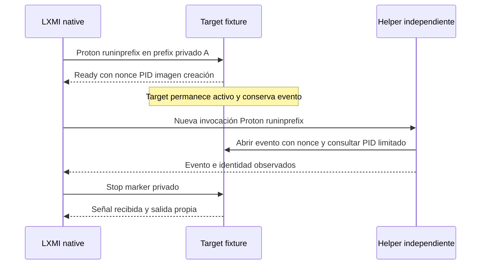

# LXMI 0.8.6 — Existing Wine Context Re-entry

Fecha: 2026-10-01 UTC / America/La_Paz. **COMPROBADO:** reentrada independiente same-prefix verificada para el fixture. Control different-prefix no verificado. Producto 0.8.6. Ningún loader o proceso del juego ejecutado; no se inicia 0.9.

## Fuentes fijadas — UPSTREAM VERIFIED

| Repositorio | Referencia / commit | Archivos / secciones |
|---|---|---|
| wine-mirror/wine | wine-11.0 / db11d0fe6a169c457e23d007e20404643d067aa8 | dlls/ntdll/unix/server.c: init_server_dir, setup_config_dir, server_connect; server/request.c: create_server_dir, acquire_lock |
| Mismo Wine | mismo commit | dlls/ntdll/unix/loader.c: WINEPREFIX, WINEARCH, WINESERVER |
| ValveSoftware/Proton | proton_10.0 / e91ca2be0df2cef4c230cbbc0b86604d73a0bbf6 | proton: CompatData.prefix_dir, init_wine, init_session, dispatch runinprefix |

Se releyó el source Wine fijado y el Proton fijado conservado de 0.8.4 (`/tmp/lxmi-proton-pinned.py`, SHA-256 f07e19d289a4c7a1a9047bb123a2f630b54ceef1ee2ba0d96d1990a68055635e). El source documental no se presenta como commit exacto del Experimental local. El fetch web del Proton fijado no estuvo disponible en esta revisión; se usó el archivo fijado cuyo digest coincide con la investigación previa.

El cliente Wine calcula un directorio endpoint usando el prefix filesystem y el UID, intenta conectar al socket existente y puede arrancar el server si no está disponible. El servidor usa prefix dev/inode y UID para `/tmp/.wine-<uid>/server-<dev-hex>-<inode-hex>/`, con socket y lock; no se usa solo el texto WINEPREFIX. [Cliente fijado](https://github.com/wine-mirror/wine/blob/db11d0fe6a169c457e23d007e20404643d067aa8/dlls/ntdll/unix/server.c), [server fijado](https://github.com/wine-mirror/wine/blob/db11d0fe6a169c457e23d007e20404643d067aa8/server/request.c).

**DERIVED:** alias textuales de un mismo directorio pueden tener igual dev/inode y, bajo esa fórmula, igual endpoint candidato; no se ejecutó control por symlink. El harness sigue rechazando symlinks en su root. WINEARCH es arquitectura, WINESERVER selecciona un binario; ninguno prueba una instancia concreta. [Loader fijado](https://github.com/wine-mirror/wine/blob/db11d0fe6a169c457e23d007e20404643d067aa8/dlls/ntdll/unix/loader.c).

Proton construye `pfx/` desde STEAM_COMPAT_DATA_PATH y establece WINEPREFIX para la sesión. runinprefix ejecuta el Wine de la tool con argv independiente, no requiere lanzar B como child Windows de A. Preparación/mantenimiento y Wine pueden escribir en el prefix; runinprefix no garantiza read-only. [Proton fijado](https://github.com/ValveSoftware/Proton/blob/e91ca2be0df2cef4c230cbbc0b86604d73a0bbf6/proton).

## Coordinación — COMPROBADO

Se reutilizan el executor, staging, límites y coordinador de identidad de 0.8.5.1. Nuevo helper `lxmi-context-reentry-helper.exe`, compilado del mismo preflight con LXMI_REENTRY_ONLY: el código que carga 3dmloader/llama Inject queda excluido de esa build. Solo se copian target y helper, no DLLs; no se requiere package upstream.

El target existente conserva sus modos anteriores y añade context-reentry: crea `Local\LXMIReentryV1-<nonce>`, reporta PID Windows/imagen exacta/FILETIME/nonce y publica ready completo. El controller registra su child Linux del launcher con start ticks, espera ready y retrasa B 300 ms. B arranca con otra llamada al executor; no es child Windows del target ni depende del pipe para iniciarse. Abre el evento exacto y consulta solo el PID esperado con PROCESS_QUERY_LIMITED_INFORMATION. A confirma que recibió la señal. El binding sigue exigiendo imagen de sesión, creación y nonce; no se enumeran procesos.

No se afirma que el Mermaid se haya renderizado. Proceso Linux del launcher, Windows PID e identidad de server son conceptos distintos. Los PIDs y FILETIME son efímeros, no autenticación criptográfica.

## HOST TEST — resultado limitado

Tool explícita Proton Experimental `1790244902 experimental-11.0-20260924-x86_64`. Paths bajo `$XDG_DATA_HOME/lxmi/tests/context-reentry-v1/<nonce>/loader-v1/`; compat-a y compat-b son contexts privados. Root sesión 0700. Target y helper en carpetas distintas, runtime sin payload DLL.

| Campo | Same-prefix | Different-prefix |
|---|---|---|
| Resultado | VERIFIED | PrefixMismatch, no verificado |
| Target preexistente al helper | Ready antes de nueva invocación | Ready antes de nueva invocación |
| Filesystem marker | Ambos legibles | Ambos legibles |
| Evento de A visible desde B | Sí; A confirma señal | No |
| Target binding | Verified, imagen/FILETIME coinciden | PidCollision: PID resuelve al propio helper B |
| Prefix dev/inode | Coinciden | Distintos |
| Endpoint candidato | Misma ruta/socket observado | Rutas distintas; sockets candidatos observados |
| Wineserver PID/conexión exacta | UNKNOWN | UNKNOWN |
| Loader / Inject | No ejecutados | No ejecutados |

Same-prefix nonce `db572a81dd935ebb124d3f81e49f31c3`, Windows target PID 220 / helper 236, creación `134353008718097970`. Dev/inode `66306/12235854`. Endpoint candidato `/tmp/.wine-1000/server-10302-bab44e/socket`; socket inode `29387698` durante sesión.

Different-prefix nonce `bc635e87cb78d4de17da32ce150f79c9`, target y helper Windows PID `216` simultáneamente. Imagen consultada termina en `runner/lxmi-context-reentry-helper.exe`, no en target; creación esperada `134353032240502980` / consultada `134353032248383950`. Dev/inodes A `66306/12238544` y B `66306/12452040`. No error de Inject: no existe llamada.

**Conclusión permitida:** una segunda invocación independiente de Proton usando el mismo prefix aislado probado pudo incorporarse al contexto del target LXMI ya activo. No demuestra entrada al contexto ZZZ ni compatibilidad ZZMI, Direct Inject o Hook con el juego.

## Endpoint evidence / cleanup

WineServerEndpointEvidence registra UID, canonical prefix/dev/inode, ruta derivada y socket lstat (tipo socket, owner, dev/inode). La ruta es DERIVED según source fijado, la existencia/metadata del socket es LOCAL OBSERVED. No se conecta al socket, lee memoria, enumera procesos ni obtiene PID por env. No prueba que cada peer se conectase al endpoint exacto observado, por lo que server_pid permanece None/UNKNOWN.

Tras salir los fixtures, el socket A todavía existía en el snapshot inmediato. Una lectura posterior de las tres rutas derivadas de CLI constató que ya no estaban presentes, sin enviar señales ni ejecutar wineserver. Esto es evidencia de desaparición de sockets candidatos, no seguimiento de un PID wineserver hasta su salida. No kill global ni cleanup del prefix del juego.

## Inventario ligero de mutaciones

Snapshot después de bootstrap y antes de A/B, y después de salida: prefix directory, system.reg, user.reg, userdef.reg, dosdevices y c:/z: con size/mtime/inode/link target. No tree hash ni registro completo.

Same-prefix: cambiaron directory/mtime, dosdevices/mtime y los tres registros (mtime/inodes; system.reg pasó de 3912516 a 3912636 bytes); targets c:/z: vigilados estables. Control cross-prefix: snapshot de A cambió dosdevices/mtime; no demuestra que B no escribiera en su prefix porque el inventario actual compara A. Atribución exclusiva de cada write a A, B, bootstrap o flush: UNKNOWN. Los peers no escriben registry; las variaciones son compatibles con mantenimiento normal Wine/Proton.

GamePrefixEntryRisk es declarativo: entry puede inicializar/actualizar registry, mappings y metadata; reversibilidad y alcance completo UNKNOWN; requiere backup y consentimiento separado. No ejecutar un helper en 4162040 solo porque el fixture pasó.

## Comparación con observación histórica ZZZ

0.8.3 LOCAL OBSERVED: Proton Experimental, AppID 4162040, compatdata4162040/pfx, wineserver candidato por entorno. El fixture usa selección lab explícita, otro compatdata y otro prefix filesystem; el build común no los convierte en un contexto compartido. GameRuntimePlan.selected sigue Unknown.

GameContextJoinPlan incorpora solo evidencia de reentrada del fixture; GamePrefixReentry y loader game compatibility NotTested, server exacto UNKNOWN. LoaderStrategyDecision NoDecision, Hook guard intacto, readiness/gate cerrados. La UI muestra esa separación; evaluación sin input package seleccionado conserva NotReady, no prueba ausencia del runtime en disco.

## Límites

Control symlink y diferente Proton: NO COMPROBADO, no necesarios para la conclusión acotada. Regresión late Direct Inject opcional: no ejecutada para mantener este incremento como probe sin loader. No se inicia 0.9 ni preflight game-facing.
